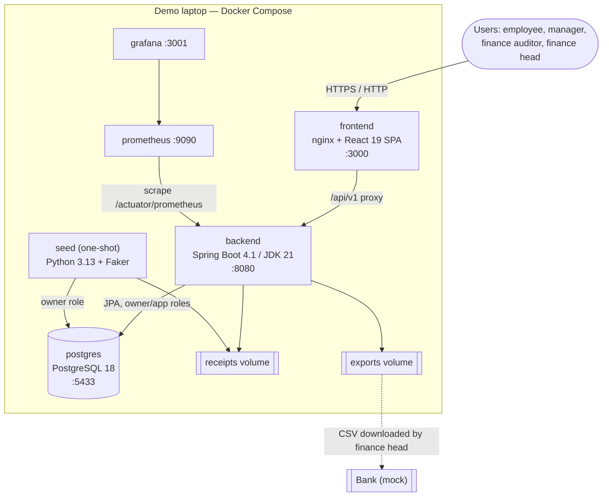
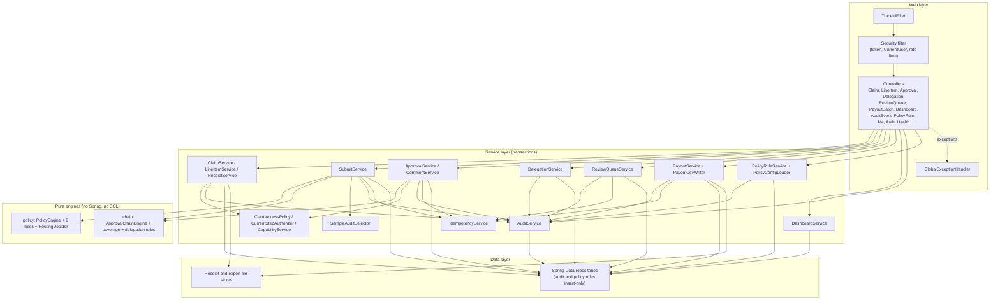
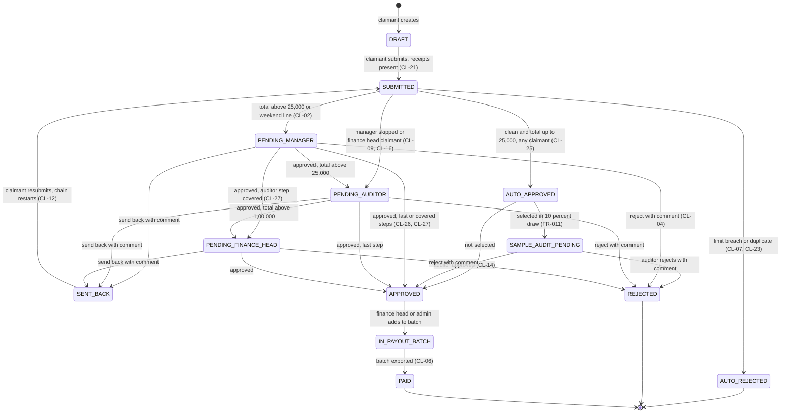
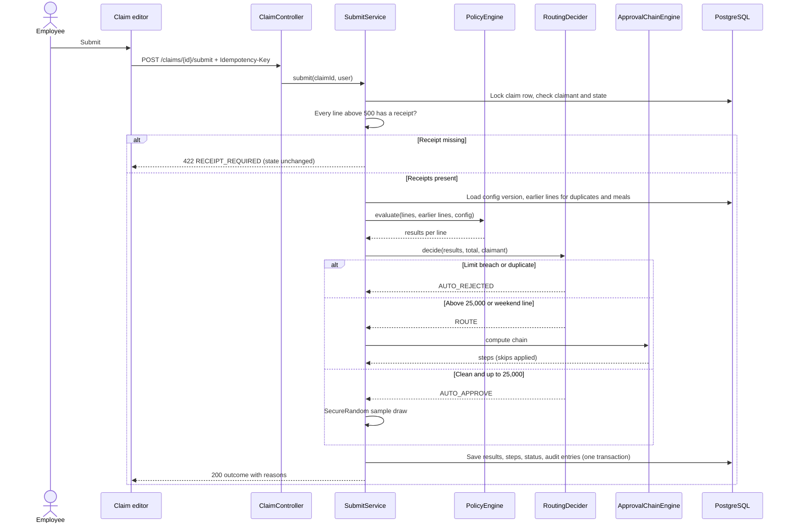
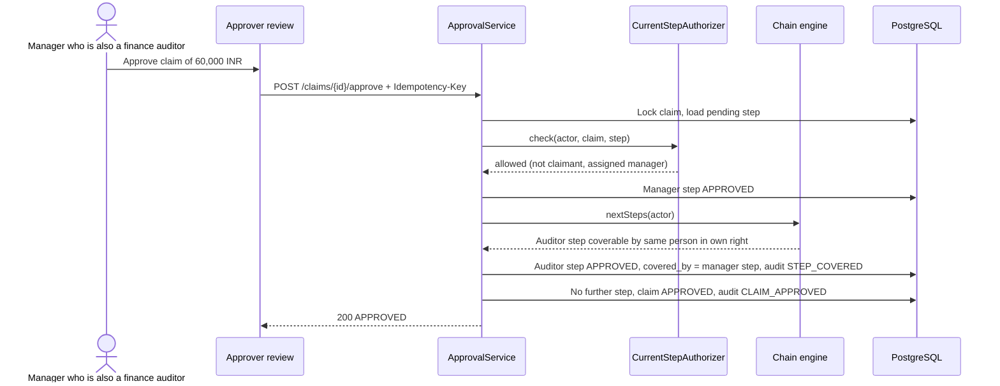
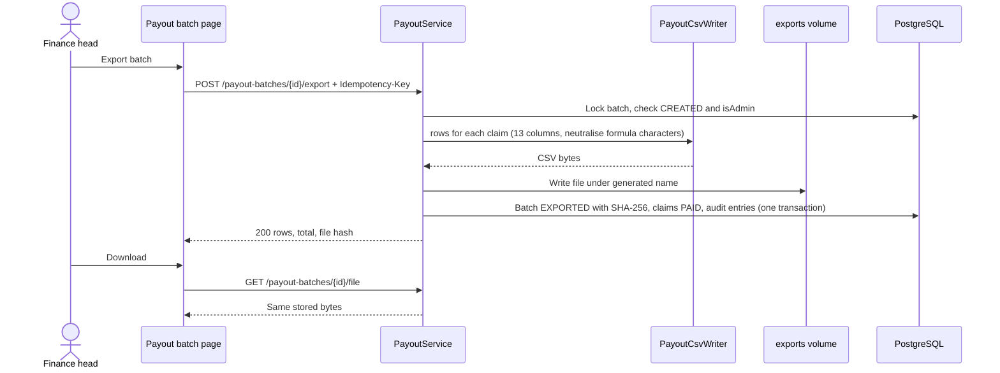
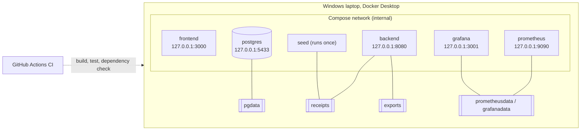

# Architecture Diagrams — ExpenseFlow

| Field | Value |
|---|---|
| Version | 2.0 — **proposed, for review and approval** (replaces the template v0.1) |
| Date | 2026-11-27 |
| Basis | Requirement baseline v1.3; repository snapshot `main` @ `fe7ee73` |

All diagrams use Mermaid and render in GitHub, VS Code and most Markdown viewers. The system context and security-boundary diagrams are in `system-context.md`; this file holds the container, component, state, sequence and deployment views.

## 1. Container diagram

## 2. Backend component diagram

## 3. Frontend component diagram

```mermaid
flowchart LR
    subgraph Shell
        APP["App.jsx routes"] --> RA["RequireAuth"] --> RG["RoleGate"] --> AL["AppLayout"]
    end
    subgraph Pages
        S1["S-01 Login"]
        S2["S-02 My claims"]
        S3["S-03 Claim editor"]
        S4["S-04 Claim detail"]
        S5["S-05 Approvals"]
        S6["S-06 Approver review"]
        S7["S-07 Review queue"]
        S8["S-08 Delegations"]
        S9["S-09/10 Payout"]
        S11["S-11 Dashboard"]
        S12["S-12 Audit trail"]
        S13["S-13 Policy rules"]
    end
    subgraph Shared["Reusable components"]
        DT["DataTable + FilterBar + BulkActionBar"]
        FF["FormField + ErrorSummary + MoneyInput"]
        RV["ReceiptViewer + ReceiptUpload"]
        PRL["PolicyResultList + ApprovalSteps"]
        CD["ConfirmDialog"]
        ST["Loading / Empty / Error / Forbidden states"]
    end
    subgraph Data["Data access"]
        HK["hooks: useQuery, useMutation"] --> MOD["api modules"] --> CL["client.js"]
        CTX["AuthContext / ClientConfigContext"]
    end
    AL --> Pages
    Pages --> Shared
    Pages --> HK
    Pages --> CTX
    CL -->|"/api/v1"| BE[("backend")]
```

## 4. Claim state machine (baseline v1.3)

`SUBMITTED` and `AUTO_APPROVED` are transient (recorded in the audit trail only). Every transition is enforced on the server, checks the actor and writes an audit entry in the same transaction; anything else returns `409 STATE_CONFLICT`.

## 5. Sequence — submit a claim (J1)

## 6. Sequence — approve with same-person coverage (J2, CL-27)

## 7. Sequence — export a payout batch (J7)

## 8. Deployment view

Start-up order: `postgres` healthy → `backend` runs Flyway and becomes healthy → `seed` runs once → `frontend`, `prometheus`, `grafana`. Reset: `docker compose down -v` then `up` (the audit trigger blocks deletes by design).
