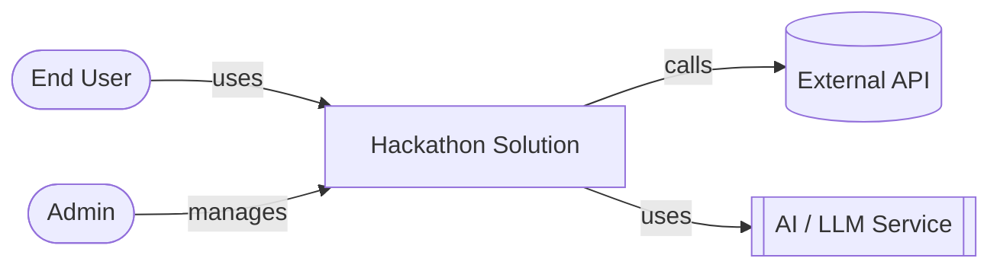
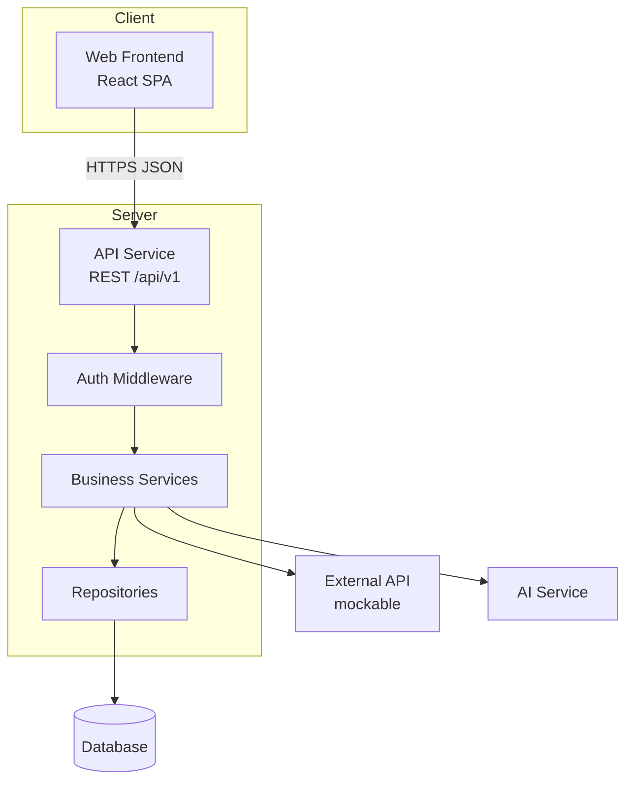
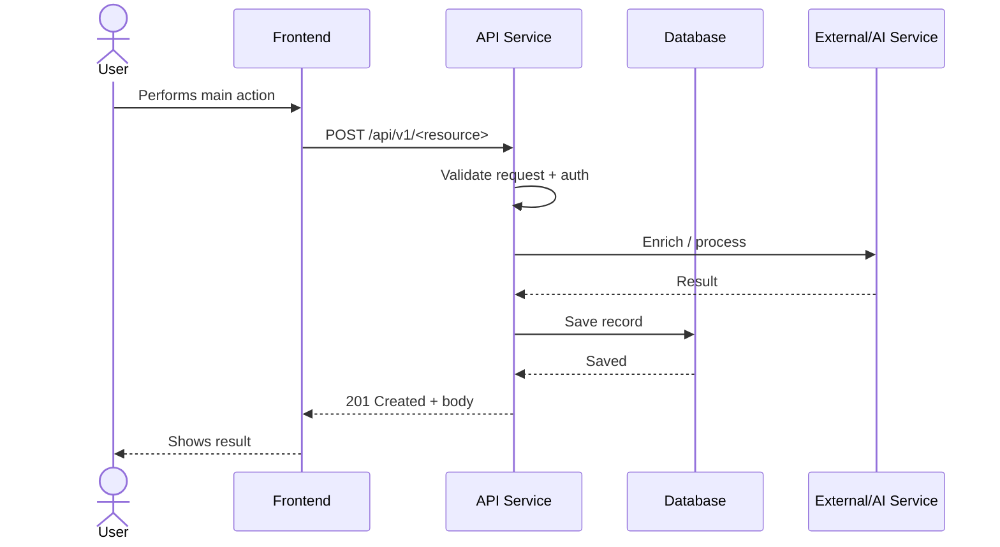
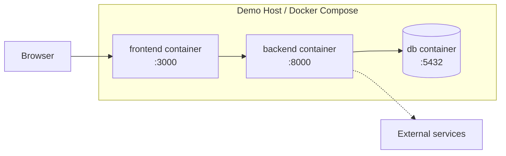

# Architecture Diagrams

All diagrams use [Mermaid](https://mermaid.js.org/) so they render in GitHub, GitLab, VS Code and most Markdown viewers. Replace the placeholder names with real components.

## 1. System Context

## 2. Component Diagram

## 3. Sequence — Main Demo Flow

## 4. Deployment

## 5. Notes
- Keep diagrams in sync with `solution-design.md`.
- Export PNGs to `demo/screenshots/` for slides if needed (`npx @mermaid-js/mermaid-cli -i architecture-diagram.md`).
