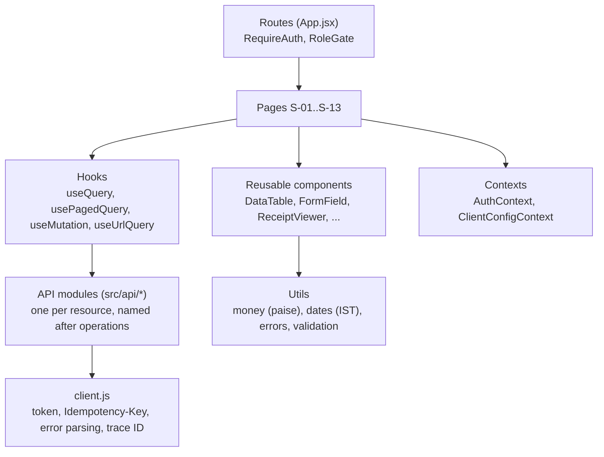
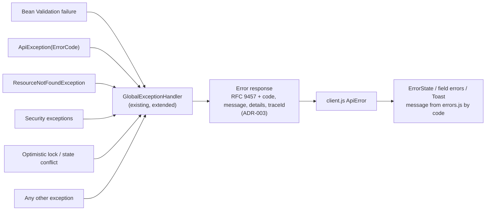

# Component Design — ExpenseFlow

| Field | Value |
|---|---|
| Version | 1.0 — **proposed, for review and approval** |
| Date | 2026-11-27 |
| Basis | Requirement baseline v1.3; repository snapshot `main` @ `fe7ee73`; team specs v0.2–v0.3 |
| Detailed design it builds on | `architecture/SPEC.md` (backbone), `backend/SPEC.md`, `frontend/SPEC.md`, `database/SPEC.md`, `ops/SPEC.md` — reused wherever they match the baseline; differences are listed in §9 and in `architecture-decisions.md` |

## 1. Current state of the repository

### 1.1 What exists and will be reused

| Area | Existing asset | Reuse decision |
|---|---|---|
| Backend | Spring Boot 4.1.3, Java 21, Maven wrapper; starters webmvc, data-jpa, validation, actuator; Micrometer Prometheus; Lombok; devtools | **Keep all.** Basis for every backend module |
| Backend | `GlobalExceptionHandler` (`@RestControllerAdvice`, RFC 9457 `ProblemDetail`) | **Extend**, do not replace — add domain codes (ADR-003) |
| Backend | `ResourceNotFoundException` | Keep; maps to `404 NOT_FOUND` |
| Backend | `BaseEntity` (`Long` identity id, `createdAt`, `updatedAt`) | Keep the timestamps; ID type decided in ADR-006 |
| Backend | `WebConfig` (CORS from `app.cors.allowed-origins`) | Keep |
| Backend | `HealthController` + test | Keep as API-001 |
| Backend | Actuator: health, info, prometheus exposed | Keep; add custom metrics |
| Frontend | React 19, React Router 7, Vite 8 | Keep |
| Frontend | `src/api/client.js` (single fetch wrapper, `ApiError`) | **Extend**: base `/api/v1`, Bearer token, blob/FormData, Idempotency-Key, new error shape |
| Frontend | `Layout.jsx`, `App.jsx` routes, `index.css` | Evolve into `AppLayout`, route map, design tokens |
| Frontend | oxlint | Keep (ADR-009) |
| Edge | nginx (proxies `/api/` → backend), Vite dev proxy | Keep |
| Platform | Docker Compose: postgres 18, backend, frontend, prometheus, grafana | Keep; add `seed`, volumes, DB roles, pinned tags |
| Ops | `ops/prometheus/prometheus.yml` scraping `/actuator/prometheus`; Grafana datasource provisioning | Keep; add alert rules and dashboard |
| CI | GitHub Actions: `mvnw verify`, `npm ci/lint/build`, `docker compose build` | Keep; add pytest, frontend tests, dependency check |

### 1.2 Differences between the code and the agreed standards

| # | Difference | Resolution |
|---|---|---|
| D-1 | Error body is RFC 9457 (`status`, `title`, `detail`); CLAUDE.md §11.4 and the team spec require `code`, `message`, `details`, `traceId` | ADR-003 (Proposed) |
| D-2 | `spring.jpa.hibernate.ddl-auto=update`; team spec plans Flyway with `validate` | ADR-005 (Proposed) |
| D-3 | `BaseEntity` uses `Long` identity IDs; team spec proposes UUIDv7 (ASM-S-06) | ADR-006 (Proposed) |
| D-4 | Backend tests use H2 (not in the approved stack) | ADR-008 (Proposed) |
| D-5 | No authentication yet | ADR-004 (Proposed) |
| D-6 | Backend connects as the `postgres` superuser; defaults `postgres`/`admin` passwords in compose | ADR-005, ADR-010 |
| D-7 | Prometheus and Grafana images use `latest` | ADR-010 |
| D-8 | No receipts or exports volume; nginx body limit 1 MB | ADR-010, OQ-021 |
| D-9 | Team spec predates baseline v1.3 (CL-21–CL-27) | §9 and ADR-002 |

## 2. Container view

| Container | Technology | Responsibility | Owns |
|---|---|---|---|
| `frontend` | React 19 SPA built by Vite, served by nginx | Screens, client-side validation (UX only), state display, calling the API | Nothing persistent |
| `backend` | Spring Boot 4.1 on JDK 21 | **All** business rules, validation, authorisation, state transitions, audit, CSV export, metrics | Business logic |
| `postgres` | PostgreSQL 18 | Integrity constraints, append-only audit enforcement | All data |
| `receipts` / `exports` volumes | Docker volumes | Receipt files; exported bank files | Files |
| `seed` | Python 3.13, Faker, psycopg (one-shot) | Load synthetic data | — |
| `prometheus` / `grafana` | Docker images | Scrape metrics, alert, dashboard | Metrics |

## 3. Frontend component architecture

### 3.1 Layers

Rule: pages call hooks; hooks call API modules; only `client.js` calls `fetch`. Components never call the API directly.

### 3.2 Screens (from `frontend/SPEC.md`, unchanged)

| Screen | Route | Gate (UX only) | Journeys |
|---|---|---|---|
| S-01 Login | `/login` | Public | J0 |
| S-02 My claims | `/claims` | Any | J1, J4 |
| S-03 Claim editor (mobile-first) | `/claims/new`, `/claims/:id/edit` | Claimant, editable states | J1, J3 |
| S-04 Claim detail | `/claims/:id` | Server visibility rule | J1 |
| S-05 Approvals queue | `/approvals` | `isApprover` | J2 |
| S-06 Approver review (side by side) | `/approvals/:id`, `/review-queue/:id` | Server visibility rule | J2, J3, J4, J6 |
| S-07 Review queue | `/review-queue` | `FINANCE_AUDITOR` | J6 |
| S-08 Delegations | `/delegations` | `canDelegate` | J5 |
| S-09 / S-10 Payout batches | `/payout-batches[/:id]` | `isAdmin` | J7 |
| S-11 Dashboard | `/dashboard` | Auditor or `isAdmin` | J8 |
| S-12 Audit trail | `/audit-trail` | `isAdmin` | J8 |
| S-13 Policy rules | `/policy-rules` | `isAdmin` | J8 |

### 3.3 Reusable components

`AppLayout`, `RequireAuth`, `RoleGate`, `DataTable` (server paging, sorting, selection, card layout on phones), `Pagination`, `BulkActionBar`, `FilterBar`, `StatusBadge`, `MoneyDisplay` / `MoneyInput` (₹ with Indian grouping, strings in, strings out), `DateDisplay` (IST), `FormField`, `ErrorSummary`, `LineItemForm`, `ReceiptUpload`, `ReceiptViewer`, `PolicyResultList`, `ApprovalSteps`, `CommentList`, `AuditHistory`, `ConfirmDialog` (comment mode none / optional / required), `LoadingState`, `EmptyState`, `ErrorState`, `ForbiddenState`, `Toast`. Full props in `frontend/SPEC.md` §5.

**Change for v1.3:** `PolicyResultList` shows duplicates as a reason for auto-rejection (CL-23), not as a flag to review; `ApprovalSteps` shows steps "covered by the same approver" (CL-27).

### 3.4 State, validation and duplicate-submit protection

- **Session:** `AuthContext` holds the user and capabilities from API-003. Token in memory only (ADR-004).
- **Server data:** fetched per screen through hooks; no global cache library.
- **Client validation:** mirrors the contract (required fields, amount > 0 with 2 decimals, category list from API-037, receipt rule hint). The backend re-validates everything.
- **Duplicate submits:** `useMutation` ignores clicks while pending and buttons are disabled; every state-changing action sends an `Idempotency-Key` that is reused on retry.
- **States:** every data screen renders loading, empty, success and error; `ErrorState` shows the message and the trace ID.

## 4. Backend service architecture

### 4.1 Packages (from `backend/SPEC.md` §2)

Root `com.hackathon.backend`, layered packages plus two framework-free engines:

| Package | Responsibility |
|---|---|
| `controller` | HTTP mapping only; one controller per resource |
| `service` | Use cases and transactions: `ClaimService`, `LineItemService`, `ReceiptService`, `SubmitService`, `ApprovalService`, `CommentService`, `DelegationService`, `ReviewQueueService`, `PayoutService`, `PayoutCsvWriter`, `DashboardService`, `AuditService`, `PolicyRuleService`, `PolicyConfigLoader`, `SampleAuditSelector`, `ClaimAccessPolicy`, `CurrentStepAuthorizer`, `CapabilityService`, `IdempotencyService`, `AuthService` |
| `repository` | Spring Data JPA; audit and policy-rule repositories are insert-only |
| `domain` | Entities and enums |
| `dto` | Request and response records with Bean Validation |
| `security` | Token service and filter, `CurrentUser`, rate limiter |
| `exception` | `ErrorCode`, `ApiException`, `GlobalExceptionHandler` (existing, extended), `TraceIdFilter` |
| `config` | `WebConfig` (existing), security, clock, random source, metrics, Jackson |
| **`policy`** (pure Java) | `PolicyEngine`, one class per rule, `RoutingDecider` |
| **`chain`** (pure Java) | `ApprovalChainEngine`, `CurrentStepAuthorizer` rules, delegation rules |

The two engines have no Spring, JPA or SQL imports; time and randomness are passed in. A JUnit test fails the build if that rule is broken. Their JUnit tests are written first (CL-18, NFR-015).

### 4.2 Submit pipeline and routing (updated for v1.3)

One transaction, claim row locked (`SubmitService`):

1. Caller is the claimant; state is `DRAFT` or `SENT_BACK`.
2. At least one line; every line above `receipt.mandatory_above` has a receipt → otherwise `422 RECEIPT_REQUIRED`, **state unchanged** (CL-21).
3. Record the policy config version on the claim (protects in-flight claims from config changes).
4. Policy engine evaluates every line → `policy_results`.
5. **RoutingDecider, fixed order:**
   1. any limit breach (BR-001–BR-004) **or any duplicate** (BR-006, BR-007, BR-009) → `AUTO_REJECTED` with reasons (CL-07, **CL-23**);
   2. else total > `approval.auditor_threshold` or any weekend line → compute chain → first `PENDING_*` (CL-02);
   3. else → auto-approve — **for every claimant, including the finance head** (**CL-25**) → sample draw → `SAMPLE_AUDIT_PENDING` or `APPROVED`.
6. Audit entry for every state passed through.

Duplicate scope (CL-22): vendor + amount + date against the claimant's earlier lines; receipt hash and date + receipt number against everyone's earlier lines.

### 4.3 Approval-chain engine (updated for v1.3)

1. **Claimant is the finance head and the claim was routed** → one `FINANCE_AUDITOR` step, any amount (CL-16).
2. Otherwise level 1 `MANAGER` always; level 2 `FINANCE_AUDITOR` if total > 25,000; level 3 `FINANCE_HEAD` if total > 1,00,000.
3. A step with **no approver** is skipped and the claim moves to the next level, adding it if needed (CL-09). A step whose only possible approver is the claimant is skipped the same way (ASM-009, unconfirmed).
4. **Same-person coverage (CL-26, CL-27, new):** when a user approves step *n*, each following step that **the same user could approve in their own right** (assigned manager, or holder of the pool role) and that is not their own claim is marked `APPROVED` with `covered_by_step_id = n`, and an audit entry `STEP_COVERED` is written. Coverage stops at the first step the user cannot approve. Whether approving **as a delegate** also covers later steps is an open decision (ADR-002, UD-01): recommended **no**.
5. Steps are stored when the claim is submitted; later config changes never re-route a claim in flight. On resubmission, old steps become `SUPERSEDED` and the chain restarts (CL-12).

### 4.4 Responsibilities by layer

| Concern | Frontend | Backend | Database |
|---|---|---|---|
| Field validation | Mirror rules, show messages | **Enforce** (Bean Validation, unknown fields rejected) | Types, NOT NULL, CHECK |
| Policy limits, duplicates, routing | Show hints and results | **Decide** (pure engines) | Unique (date + receipt no.), indexes |
| Who may see / act | Hide links and buttons | **Enforce** (role, object, state) | — |
| State transitions | Show allowed actions from API | **Enforce** state machine, row lock | Status CHECK |
| Audit | Display history | Write in same transaction | Trigger blocks UPDATE/DELETE/TRUNCATE; app role insert-only |
| Money | Format ₹, sum in paise for display | `BigDecimal` scale 2 | `NUMERIC(12,2)` |

## 5. Error handling architecture

- One handler, one shape. HTTP status and `code` follow the team spec catalogue (400 `VALIDATION_FAILED` … 500 `INTERNAL_ERROR`).
- 404 is used for "not found **or not visible**", so claim IDs cannot be probed (B-10).
- Unexpected errors are logged with the trace ID; the response never contains stack traces, SQL or file paths.
- The frontend maps `code` to a user message; unknown codes fall back to a generic message with the trace ID.
- Business failures that leave state unchanged (e.g. `RECEIPT_REQUIRED`) return per-line `details` so the UI can mark the right lines.

## 6. Logging and monitoring

| Signal | Implementation | Use |
|---|---|---|
| Trace ID | `TraceIdFilter` sets `X-Trace-Id` on every response, in the logging context and in error bodies | Correlate a user report with logs |
| Application logs | SLF4J (Spring Boot default Logback), levels info/warn/error; never receipts, passwords, tokens or bank details | Diagnosis |
| Audit trail | `audit_events` table — business record, not a log | FR-018, evidence |
| Metrics | Micrometer: `expenseflow_approval_queue_size{step}`, `expenseflow_oldest_pending_approval_seconds{step}`, `http_server_requests_seconds` (histogram) | NFR-008 |
| Alert | Prometheus rule on `expenseflow_oldest_pending_approval_seconds` above the runbook threshold (OQ-042) | NFR-008 |
| Dashboard | Grafana provisioned dashboard: queue size, approval age, API latency | NFR-008 |
| Health | `/api/v1/health` (UI), `/actuator/health` (container healthcheck) | NFR-006 |
| Runbook | `ops/runbook.md` (Phase 8) | NFR-010 |

## 7. Security controls (summary)

| Threat / bypass | Control | Ref |
|---|---|---|
| Reading others' claims (IDOR) | `ClaimAccessPolicy` on every read; 404 when not visible | FR-019, B-10 |
| Approving own claim | Self-approval check first, including bulk approve, sample audit and coverage | BR-017, B-02 |
| Delegation abuse | Delegate must be auditor or finance head, not the delegator, no re-delegation, dated window | BR-020, B-03 |
| Editing after submit | Lines editable only in `DRAFT`/`SENT_BACK` | B-04 |
| Lowering amount during send-back | Resubmission re-runs policy and recalculates the chain | BR-019, B-05 |
| Skipping a step via the API | State machine enforced server-side; row lock; idempotency | B-06 |
| Renamed duplicate receipt | SHA-256 of content | BR-007, B-07 |
| Config change to pass a pending claim | Config version stored on claim; admin-only; audited | BR-027, B-08 |
| Paying twice / unapproved | Batch accepts only eligible claims; one batch per claim | BR-024, B-09 |
| Tampering with the audit trail | Trigger + insert-only DB role + no update code path | NFR-004, B-11 |
| Dodging sample audit | Server-side `SecureRandom` draw, value stored in audit | BR-022, B-12 |
| Spreadsheet formula injection | Neutralise `= + - @` tab CR in CSV | NFR-019 |
| Malicious upload | Size limit, content-type sniffing, generated names, served only to authorised users | NFR-018 |
| Brute-force login | Rate limit on API-002 | NFR-016 |
| Secrets leak | Env vars, placeholders only, CI secret scan | NFR-017 |

## 8. Data flow for each major user journey

Format: **User action → Frontend → API → Backend service → Database / external → Response → UI.**

### J0 — Sign in
| Step | User action | Frontend | API | Backend service | DB / external | Response | UI |
|---|---|---|---|---|---|---|---|
| 1 | Enters email and password | S-01 validates format | POST `/auth/login` (API-002) | `AuthService` checks rate limit, BCrypt hash | `users` read; `audit_events` LOGIN_* | 200 token / 401 / 429 | Stores token in memory |
| 2 | — | AuthContext loads profile | GET `/me` (API-003) | `CapabilityService` | `users`, `delegations` | 200 role + capabilities | Nav built from capabilities; go to `/claims` |

### J1 — Create, save and submit a claim (US-003–US-006, US-009, US-013–US-017, US-043)
| Step | User action | Frontend | API | Backend service | DB / external | Response | UI |
|---|---|---|---|---|---|---|---|
| 1 | Starts a new claim | S-03 | POST `/claims` (API-005) | `ClaimService` creates `DRAFT`, claim number | `claims`, `audit_events` | 201 claim | Editor opens |
| 2 | Adds a line (category, amount, date, vendor, receipt no.; hotel city and dates) | `LineItemForm` checks required fields, amount, categories (API-037) | POST `/claims/{id}/line-items` (API-007) | `LineItemService` validates, state must be editable | `claim_line_items`, `audit_events` | 201 line / 400 field errors | Line listed; errors beside fields |
| 3 | Uploads a receipt (camera or file) | `ReceiptUpload` with progress | POST `.../receipt` (API-010) | `ReceiptService`: size, type by content, SHA-256, generated name | `receipts`; receipts volume | 201 / 413 / 415 | Thumbnail; clear error |
| 4 | Saves draft | Nothing extra — data already saved per line | — | — | — | — | "Draft saved" |
| 5 | Submits | Button disabled, Idempotency-Key | POST `/claims/{id}/submit` (API-012) | `SubmitService` → receipt check → `PolicyEngine` → `RoutingDecider` → `ApprovalChainEngine` or sample draw | `claims` (locked), `policy_results`, `approval_steps`, `audit_events` | 200 outcome; 422 `RECEIPT_REQUIRED` with lines | Outcome page: auto-approved / auto-rejected with reason per line (limit or duplicate) / routed with next approver |

### J2 — Approve through the chain (US-018, US-021, US-022, US-024, US-025)
| Step | User action | Frontend | API | Backend service | DB / external | Response | UI |
|---|---|---|---|---|---|---|---|
| 1 | Opens approvals | S-05 | GET `/approvals` (API-014) | `ApprovalService` lists pending steps for user or delegator | `approval_steps`, `claims`, `delegations` | 200 page | Oldest first |
| 2 | Opens a claim | S-06 side by side | GET `/claims/{id}` (API-006), GET receipt (API-011), GET history (API-013) | `ClaimAccessPolicy`, `ReceiptService` | `claims`, lines, `policy_results`, steps, receipts volume | 200 + `allowedActions` | Lines left, receipt right, weekend flag, steps |
| 3 | Approves | `ConfirmDialog`, Idempotency-Key | POST `/claims/{id}/approve` (API-015) | `CurrentStepAuthorizer` (self-approval first) → step `APPROVED` → **CL-27 coverage** → activate next step or `APPROVED` | steps, `claims`, `audit_events` | 200 new state / 403 / 409 / 422 | Toast; claim leaves the queue |

### J3 — Send back and resubmit (US-008, US-019)
| Step | User action | Frontend | API | Backend service | DB / external | Response | UI |
|---|---|---|---|---|---|---|---|
| 1 | Approver sends back with comment | `ConfirmDialog` (comment required — OQ-034) | POST `/claims/{id}/send-back` (API-017) | `ApprovalService` | step `SENT_BACK`, `claim_comments`, `claims` → `SENT_BACK`, audit | 200 | Claim leaves queue |
| 2 | Employee edits and resubmits | S-03 shows comment banner | API-007–010, then API-012 | `SubmitService`: old steps `SUPERSEDED`, policy re-run, chain recalculated from manager | as J1 step 5 | 200 outcome | As J1 |

### J4 — Reject with comment (US-018, FR-020)
| Step | User action | Frontend | API | Backend service | DB / external | Response | UI |
|---|---|---|---|---|---|---|---|
| 1 | Rejects | `ConfirmDialog` comment required | POST `/claims/{id}/reject` (API-016) | `ApprovalService`; 422 `COMMENT_REQUIRED` if empty | step, comment, `claims` → `REJECTED`, audit | 200 | Employee sees `REJECTED` with comment on S-02/S-04 |

### J5 — Delegate while on leave (US-023)
| Step | User action | Frontend | API | Backend service | DB / external | Response | UI |
|---|---|---|---|---|---|---|---|
| 1 | Picks delegate and dates | S-08; delegate list from API-038 | POST `/delegations` (API-020) | `DelegationService`: role auditor/FH, not self, no overlap, no re-delegation | `delegations`, audit | 201 / 422 | Active delegation shown |
| 2 | Delegate approves during leave | S-05/S-06 | API-015 | `CurrentStepAuthorizer` accepts delegate; audit records actor and on-behalf-of | steps, audit | 200 | As J2 |

### J6 — Review queue, bulk approve, sample audit (US-026–US-028)
| Step | User action | Frontend | API | Backend service | DB / external | Response | UI |
|---|---|---|---|---|---|---|---|
| 1 | Filters queue | S-07 `FilterBar` in URL | GET `/review-queue` (API-022) | `ReviewQueueService`: auditor-step and sample-audit claims, never own | `claims`, steps, results | 200 page | Dense table |
| 2 | Selects rows, bulk approves | `BulkActionBar`, Idempotency-Key | POST `/review-queue/bulk-approve` (API-023) | Each claim in its own transaction with all J2 checks | as J2 | 200 per-claim results | Row-level success / failure |
| 3 | Reviews a sampled claim | S-06 review mode | API-015 / API-016 | `SAMPLE_AUDIT_PENDING` → `APPROVED` or `REJECTED` | `claims`, audit | 200 | Leaves queue |

### J7 — Payout (US-029, US-030)
| Step | User action | Frontend | API | Backend service | DB / external | Response | UI |
|---|---|---|---|---|---|---|---|
| 1 | Views eligible claims | S-09 | GET `/payout-batches/eligible-claims` (API-025) | `PayoutService`: `APPROVED`, not held, not batched | `claims` | 200 | Table |
| 2 | Creates batch | Idempotency-Key | POST `/payout-batches` (API-026) | All-or-nothing eligibility | `payout_batches`, `claims` → `IN_PAYOUT_BATCH`, audit | 201 / 422 | Batch detail |
| 3 | Exports | `ConfirmDialog` | POST `/payout-batches/{id}/export` (API-028) | `PayoutCsvWriter` (13 columns, injection-safe) → file + SHA-256; claims → `PAID`; one transaction | exports volume, `payout_batches`, `claims`, audit | 200 control summary | Rows, total, hash; download (API-029) |
| 4 | Hands file to bank | Browser download | GET `.../file` (API-029) | Returns stored bytes | exports volume | CSV | — (bank is mock) |

### J8 — Oversight: dashboard, audit trail, policy configuration (US-031–US-033, US-041, US-044)
| Step | User action | Frontend | API | Backend service | DB / external | Response | UI |
|---|---|---|---|---|---|---|---|
| 1 | Opens dashboard | S-11 | API-030, 031, 032 | `DashboardService` aggregates | `claims`, lines, `policy_results`, steps | 200 aggregates | Charts and figures |
| 2 | Searches audit trail | S-12 | GET `/audit-events` (API-033) | `AuditService` (read-only) | `audit_events` | 200 page | Filterable timeline |
| 3 | Changes a limit | S-13 `MoneyInput` | PUT `/policy-rules/{key}` (API-035) | `PolicyRuleService`: insert new row, bump config version, audit | `policy_rules`, audit | 200 | New value; applies to new submissions only |

### J9 — Operations (US-035–US-039)
| Step | User action | Frontend | API | Backend service | DB / external | Response | UI |
|---|---|---|---|---|---|---|---|
| 1 | `docker compose up` | — | — | Flyway migrates; seed runs once | PostgreSQL, volumes | Healthy services | App on localhost:3000 |
| 2 | Watches Grafana | Grafana | `/actuator/prometheus` (scraped) | Micrometer gauges query pending steps | `approval_steps` | Metrics | Dashboard; alert fires on old approvals |

## 9. Alignment with the team's specs

The team's specs are reused as the detailed design. These items must change in them to match baseline v1.3:

| Spec item | Current spec | Baseline v1.3 | Change |
|---|---|---|---|
| Backbone §3.3 step 5, §4.2 | Duplicates route with a flag (ASM-004) | Duplicates auto-reject (CL-23) | Move duplicates to the auto-reject branch; T-03 guard includes duplicates; T-04 guard drops them |
| Backbone §3.3, §5.2 rule 1 | Finance head's claims always routed to an auditor (SPEC-Q-14 default) | Clean claim ≤ 25,000 can auto-approve (CL-25) | Apply rule 1 only to routed claims |
| Backbone §5.3, SPEC-Q-16 | Each step approved separately | One approval covers all steps of the same person (CL-26, CL-27) | Add coverage rule, `covered_by_step_id`, `STEP_COVERED` audit action |
| Backbone §4.3 | Duplicate scope proposed | Confirmed (CL-22) | Mark as decided |
| Backbone §4.4 | Categories pending SPEC-Q-02 | Three categories (CL-24) | Mark as decided |
| Backbone §1 | Scope FR-001–020, CL-01–18 | FR-001–032, BR-001–034, CL-01–27 | Update references |
| Backend §4.4, tests | Routing tests per old order | New fixed order (§4.2 above) | Update test matrix |
| Frontend `PolicyResultList` | `DUPLICATE_FLAG` reviewed by approvers | Duplicate = rejection reason | Update copy and states |
