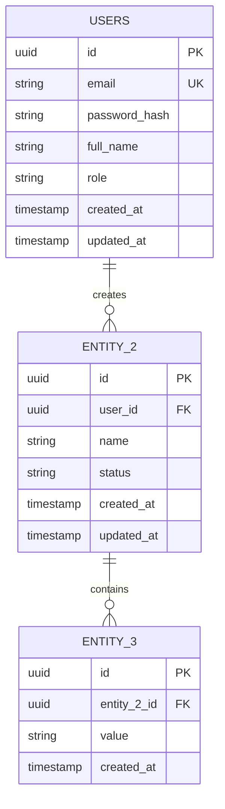

# Database Design

| Field | Value |
|---|---|
| Database | `<PostgreSQL 16 / MongoDB / SQLite>` |
| Naming | snake_case tables (plural) and columns |
| Keys | UUID primary keys `id` |
| Audit columns | `created_at`, `updated_at` on every table |
| Migrations | `database/migrations/` |
| Seed data | `database/seeds/` |

## 1. Entity List
| Entity | Description | Requirements |
|---|---|---|
| users | People who use the system | FR-… |
| `<entity_2>` | | |
| `<entity_3>` | | |

## 2. ER Diagram


## 3. Table Definitions

### users
| Column | Type | Null | Default | Constraints | Notes |
|---|---|---|---|---|---|
| id | UUID | No | gen_random_uuid() | PK | |
| email | VARCHAR(255) | No | | UNIQUE | Login |
| password_hash | VARCHAR(255) | No | | | bcrypt/argon2 |
| full_name | VARCHAR(150) | No | | | |
| role | VARCHAR(20) | No | 'user' | CHECK IN ('user','admin') | |
| created_at | TIMESTAMPTZ | No | now() | | |
| updated_at | TIMESTAMPTZ | No | now() | | |

### `<entity_2>`
| Column | Type | Null | Default | Constraints | Notes |
|---|---|---|---|---|---|
| id | UUID | No | gen_random_uuid() | PK | |
| user_id | UUID | No | | FK → users.id ON DELETE CASCADE | |
| | | | | | |

## 4. Indexes
| Table | Index | Columns | Reason |
|---|---|---|---|
| users | ux_users_email | email | Login lookup |
| `<entity_2>` | ix_entity_2_user_id | user_id | List by owner |

## 5. Data Rules
- Soft delete? `<yes/no — if yes add deleted_at>`
- Enumerations: `<status values>`
- Retention and privacy: synthetic data only for the demo; no real PII.

## 6. Seed Data Plan
| Table | Rows | Purpose |
|---|---|---|
| users | 3 | Demo user, admin, second user |
| `<entity_2>` | ~20 | Realistic data that tells the demo story |

## 7. Sample DDL (PostgreSQL)
```sql
CREATE TABLE users (
    id            UUID PRIMARY KEY DEFAULT gen_random_uuid(),
    email         VARCHAR(255) NOT NULL UNIQUE,
    password_hash VARCHAR(255) NOT NULL,
    full_name     VARCHAR(150) NOT NULL,
    role          VARCHAR(20)  NOT NULL DEFAULT 'user' CHECK (role IN ('user','admin')),
    created_at    TIMESTAMPTZ  NOT NULL DEFAULT now(),
    updated_at    TIMESTAMPTZ  NOT NULL DEFAULT now()
);
```
