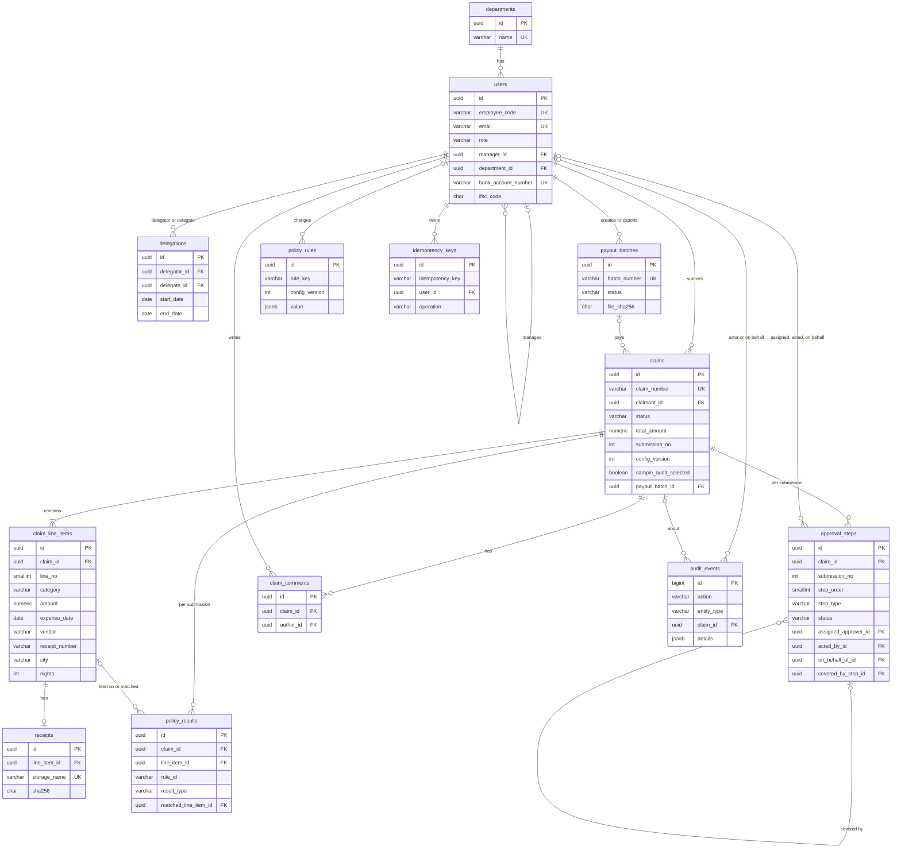

# Database Design — ExpenseFlow

| Field | Value |
|---|---|
| Version | 2.0 — **proposed, for review and approval** (replaces the template v0.1) |
| Date | 2026-11-27 |
| Database | PostgreSQL 18 in Docker (approved, CL-17) |
| Basis | Requirement baseline v1.3; team's `database/SPEC.md` v0.2 (column-level detail, indexes, seed plan) — reused; this document records the model and the **changes needed for v1.3** |

## 1. Conventions

| Item | Decision | Status |
|---|---|---|
| Names | snake_case, plural tables, `<entity>_id` foreign keys; `ix_`/`ux_`/`ck_`/`ex_`/`trg_` prefixes | From team spec |
| Primary keys | `UUID DEFAULT uuidv7()` (built into PostgreSQL 18); `audit_events.id` is `BIGINT` identity for strict order | **Proposed — ADR-006** (existing `BaseEntity` uses `Long` identity) |
| Display IDs | `EMP0001`, `CLM-YYYY-NNNNN`, `PB-YYYY-NNNN` | From team spec |
| Money | `NUMERIC(12,2)`; Java `BigDecimal`; never floating point | NFR-021 |
| Timestamps / dates | `TIMESTAMPTZ` in UTC; `DATE` for expense, hotel and delegation dates; UI shows IST | ASM-002 |
| Enums | `VARCHAR` + `CHECK` list; JPA `EnumType.STRING` | From team spec |
| Schema changes | Versioned migrations (Flyway), `ddl-auto=validate` | **Proposed — ADR-005** (code today uses `ddl-auto=update`) |

## 2. Entities

| Table | Purpose | Key columns | Requirements |
|---|---|---|---|
| `departments` | 8 departments | name (unique) | FR-027 |
| `users` | Employees and roles | employee_code, full_name, email, password_hash, role, manager_id → users, department_id, bank_account_number, ifsc_code | FR-027, FR-028, FR-030, FR-032 |
| `claims` | Claim header and state | claim_number, claimant_id, status, total_amount, submission_no, config_version, submitted_at, decided_at, sample_audit_selected(_at), payout_batch_id | FR-001–FR-014, BR-019, BR-024 |
| `claim_line_items` | Expense lines | line_no, category (MEALS/HOTEL/LOCAL_CAB), amount, expense_date, vendor, receipt_number, city, check_in_date, check_out_date, nights (generated) | FR-001, FR-021, FR-022, BR-034 |
| `receipts` | Receipt file metadata | line_item_id (one per line), storage_name, content_type, size_bytes, sha256 | FR-001, BR-007, NFR-018 |
| `policy_rules` | Policy configuration, insert-only, versioned | rule_key, config_version, value (JSONB), created_by | FR-026, BR-027, BR-030 |
| `policy_results` | One row per fired rule per line per submission, insert-only | claim_id, submission_no, line_item_id, rule_id, result_type, configured_limit, actual_value, matched_line_item_id, reason | FR-004, FR-016, FR-023 |
| `approval_steps` | The chain for each submission | submission_no, step_order, step_type, assigned_approver_id, status, activated_at, skip_reason, acted_by_id, on_behalf_of_id, acted_at, **covered_by_step_id (new)** | FR-005, FR-008, BR-013–BR-017, BR-033 |
| `claim_comments` | Comments, incl. mandatory reject/send-back text, insert-only | claim_id, author_id, body | FR-006, FR-007, BR-018 |
| `delegations` | Leave delegations | delegator_id, delegate_id, start_date, end_date, cancelled_at | FR-008, BR-020, BR-021 |
| `payout_batches` | Batches and exported file | batch_number, status (CREATED/EXPORTED), created/exported by and at, row_count, total_amount, file_sha256, file_path | FR-012–FR-014, BR-024–BR-026 |
| `idempotency_keys` | Duplicate-submit protection, 24 h | idempotency_key, user_id, operation, request_hash, response | CLAUDE.md §10.5 |
| `audit_events` | Append-only audit trail | occurred_at, actor_id, on_behalf_of_id, action, entity_type, entity_id, claim_id, from/to state, comment, details (JSONB), trace_id | FR-018, BR-029, NFR-004 |

## 3. Entity-relationship diagram

## 4. Key integrity rules

| Rule | Implementation | Requirement |
|---|---|---|
| At most one batch per claim | Single `claims.payout_batch_id`; `ck_claims_batch_state` | BR-024, B-09 |
| Sampled claims held | `ck_claims_sample_state`; payout eligibility query excludes `SAMPLE_AUDIT_PENDING` | BR-023 |
| One pending step per claim | `ux_steps_one_pending` partial unique index | FR-005 |
| No self-approval | Service check first; `trg_steps_no_self_approval` as defence in depth | BR-017, B-02 |
| Delegate role and no overlap | Service check; `trg_delegations_delegate_role`; `ex_delegations_no_overlap` (btree_gist) | BR-020, BR-021 |
| Exported batch never changes | `trg_payout_batches_locked` | BR-025 |
| Hotel fields only on hotel lines; check-out after check-in | `ck_line_hotel_fields` | FR-022 |
| Categories | CHECK IN (`MEALS`, `HOTEL`, `LOCAL_CAB`) | BR-034 (CL-24) |
| Audit append-only | `trg_audit_events_append_only` blocks UPDATE/DELETE/TRUNCATE for every role; app role has only SELECT/INSERT | NFR-004, B-11 |
| Policy config versioned | Insert-only `policy_rules`; version stored on each submitted claim | BR-027, B-08 |

**Why date + receipt number is not a UNIQUE constraint:** the owner decided a repeat must **auto-reject the claim with a reason** (CL-23). A unique index would instead fail the line insert with a database error and could never name the earlier claim. The policy engine detects it at submit (BR-009) using an index on the normalised key.

## 5. Changes to the team's database spec for baseline v1.3

| # | Change | Why |
|---|---|---|
| DB-1 | `policy_results.result_type`: rename `DUPLICATE_FLAG` to `DUPLICATE`; its effect is auto-reject, not routing | CL-23 |
| DB-2 | `approval_steps.covered_by_step_id UUID NULL` FK → `approval_steps`; check: if set, `status = 'APPROVED'` and `acted_by_id` equals the covering step's actor; no `on_behalf_of_id` (see ADR-002 / UD-01) | CL-26, CL-27 |
| DB-3 | `audit_events.action`: add `STEP_COVERED` (29 actions) | CL-27 |
| DB-4 | Remove the "ASM-004" wording from `claim_line_items` and `receipts` notes; keep both non-unique | CL-23 |
| DB-5 | Seed (§7 of the team spec): planted duplicates now produce `AUTO_REJECTED` claims; finance-head clean claims ≤ 25,000 may be auto-approved; add claims where a manager is also an auditor (coverage) | CL-23, CL-25, CL-27 |
| DB-6 | Category list and duplicate scope are decided, not pending | CL-22, CL-24 |

## 6. Indexes (summary)

Full list in the team's `database/SPEC.md` §4. The ones that carry business rules:

| Index | Supports |
|---|---|
| Normalised vendor + amount + expense_date + claimant (via claim) | BR-006 duplicate check (same employee) |
| `receipts.sha256` | BR-007 duplicate check (all employees) |
| `expense_date` + upper(trim(receipt_number)) | BR-009 duplicate check (all employees) |
| Claimant + category + expense_date | BR-001 meal-per-day check |
| `approval_steps` (status, step_type, activated_at) | Queues, oldest-pending metric |
| `claims` (status) and (claimant_id, created_at) | Lists, review queue, payout eligibility |
| `audit_events` (claim_id, id) and (occurred_at) | Claim history, audit search |

## 7. Database roles and least privilege

| Role | Used by | Rights |
|---|---|---|
| Bootstrap superuser | PostgreSQL init script only | Creates the two roles below and extensions |
| `expenseflow_owner` | Flyway migrations, seed container | DDL; owns the schema |
| `expenseflow_app` | Backend at runtime | DML on application tables; **SELECT and INSERT only** on `audit_events` and insert-only tables; no DDL |

Today the backend connects as `postgres` (superuser) — to be fixed (ADR-005).

## 8. Migrations and seed

- **Migrations (Proposed, ADR-005):** Flyway scripts in `database/migrations/` (`V1__baseline_schema.sql`, `V2__roles_and_grants.sql`, `V3__audit_trigger.sql`, `V4__policy_seed.sql`), run by the backend at start-up with the owner role; `ddl-auto=validate`.
- **Seed:** one-shot Python 3.13 container (Faker + psycopg, fixed random seed): 8 departments, 150 users with hierarchy, auditors and a finance head, synthetic bank details, 3,000 historical claims with planted limit breaches and duplicates whose states follow the v1.3 routing rules. Re-running produces the same data; reset is `docker compose down -v`.

## 9. Data volumes

| Data | Estimate | Notes |
|---|---|---|
| Users | 150 | Seed |
| Claims | 3,000 historical + demo | Seed |
| Line items | ~9,000 | Seed, 1–5 per claim |
| Audit events | ~40,000 | Several per claim |
| Receipts | Small synthetic files | Volume `receipts` |

At this size PostgreSQL needs no partitioning or caching; the indexes above keep queues and duplicate checks fast.
