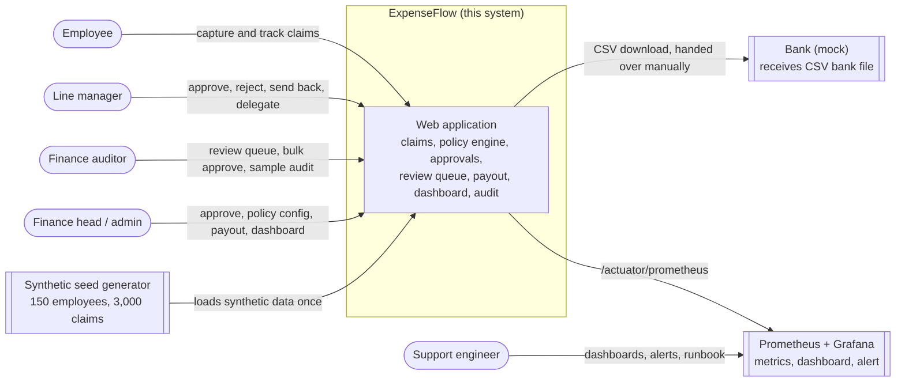
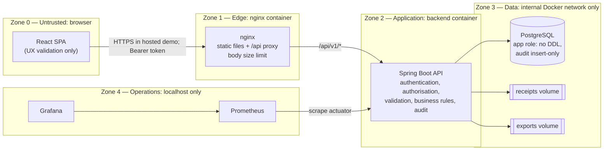
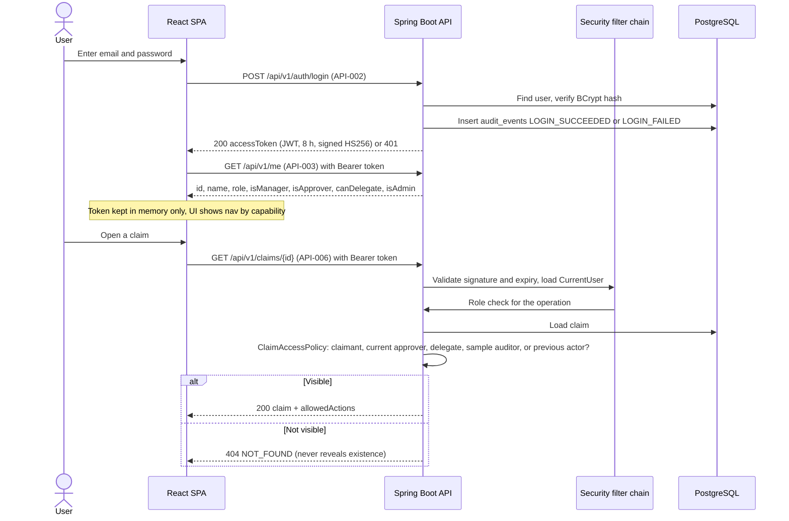

# System Context — ExpenseFlow

| Field | Value |
|---|---|
| Version | 1.0 — **proposed, for review and approval** |
| Date | 2026-11-27 |
| Produced with | `solution-architecture` skill |
| Requirement baseline | v1.3 (CLAUDE.md CL-01–CL-27; `requirements/*.md`) |
| Repository analysed | Local snapshot of `JayaMadhuriKaki/Hackathon---Team2`, `main` @ `fe7ee73` (2026-11-27), plus the team's specs (`architecture/SPEC.md` v0.3 and `backend/`, `frontend/`, `database/`, `tests/`, `ops/` SPEC v0.2). **GitHub was not re-read for this document, at the owner's request.** |
| Companion documents | component-design.md · architecture-diagram.md · database-design.md · technology-stack.md · architecture-decisions.md |

## 1. Purpose and scope

ExpenseFlow replaces email-and-Excel expense reimbursement with a web application that applies expense policy automatically, routes claims through a multi-level approval chain, gives finance auditors a review queue and a 10% sample audit, exports payouts as a bank file, and records every action in an append-only audit trail.

In scope: FR-001–FR-032, NFR-001–NFR-021, BR-001–BR-034. Out of scope: notifications and receipt OCR (US-040, US-042 — not in the requirements), claim-splitting detection (OQ-006), live bank integration, user-management screens (OQ-020).

## 2. Actors

| Actor | Role in the system | Main interactions | Requirements |
|---|---|---|---|
| Employee | Claimant | Create, save, submit, resubmit claims; upload receipts; view own claims | FR-001–FR-003, FR-019, FR-025 |
| Line manager | Approver (individual step) | Approve, reject, send back, comment, delegate | FR-005–FR-008, FR-020 |
| Finance auditor | Approver (pool step); reviewer | Auditor step above 25,000 INR; review queue, bulk approve, sample audits; approves routed finance-head claims; can be a delegate | FR-005, FR-009–FR-011, FR-024, BR-016, BR-020 |
| Finance head (also admin) | Approver (pool step); administrator | Finance-head step above 1,00,000 INR; policy configuration; payout batches; dashboard; full audit trail | FR-005, FR-012–FR-017, FR-026, BR-026, BR-027 |
| Support engineer / team | Operator | Start the stack, watch metrics and alerts, follow the runbook | NFR-006, NFR-008, NFR-010 |

Every user is also a claimant and sees their own claims (CL-15).

## 3. System context diagram

## 4. External integrations and dependencies

| Integration | Direction | Mechanism | Live? | Notes | Requirements |
|---|---|---|---|---|---|
| Bank | Out | CSV file download (13 columns, CLAUDE.md §2.8) | **No — mock.** The finance head downloads the file; nothing is sent automatically | Formula-injection protection; file stored once with SHA-256 | FR-013, BR-031, NFR-019 |
| Receipt storage | In/out | Local Docker volume `receipts` | Yes (local) | No cloud storage (AWS not allowed) | FR-001, NFR-013, NFR-018 |
| Export storage | Out | Local Docker volume `exports` | Yes (local) | Exported files re-downloadable unchanged | FR-013 |
| PostgreSQL 18 | In/out | JDBC (Spring Data JPA) | Yes (Docker) | Two DB roles: owner (migrations, seed) and app (runtime) | NFR-004, NFR-014 |
| Prometheus | Out (scraped) | HTTP pull of `/actuator/prometheus` | Yes (Docker) | Alert on oldest pending approval | NFR-008 |
| Grafana | — | Reads Prometheus | Yes (Docker) | Dashboard for queue size, approval age, latency | NFR-008 |
| Seed generator | In | Python 3.13 + Faker + psycopg, one-shot container | Yes (local) | Fixed random seed; owner DB role | FR-027–FR-030, NFR-012 |
| CI | — | GitHub Actions (existing `ci.yml`) | Yes | Tests, lint, build, dependency check | NFR-007 |

There are **no live third-party integrations** — no email, SSO, payment gateway or cloud service. This keeps the event rules (NFR-012, NFR-013) and removes integration risk.

## 5. Security boundaries

| Boundary | What crosses it | Control |
|---|---|---|
| Browser → edge | Every request | Nothing in the browser is trusted; hiding a button is UX only (CLAUDE.md §10.9) |
| Edge → API | `/api/v1/*` only | nginx proxies only the API path; request body limit ≥ receipt limit (OQ-021) |
| API entry | Every request | Token check, role and **object-level** authorisation, Bean Validation, unknown fields rejected, rate limits on login and upload (NFR-016) |
| API → data | SQL, files | Parameterised JPA only; app DB role has no DDL and cannot update or delete audit rows; files stored under generated names outside any web root (NFR-004, NFR-018) |
| Ops zone | Metrics | Ports bound to `127.0.0.1`; Grafana anonymous access off; actuator exposes only health, info, prometheus |
| Repository | Secrets | `.env` git-ignored; `.env.example` placeholders only (NFR-017) |

## 6. Authentication and authorisation flow

**Status: Proposed (ADR-004).** The sign-in method is OQ-022; the team spec's proposal (seeded users, email + password, JWT) is used here.

Authorisation has three layers, all on the server:

| Layer | Question | Where | Failure |
|---|---|---|---|
| 1. Authentication | Is the token valid? | Security filter | 401 `UNAUTHENTICATED` |
| 2. Role / capability | May this role call this operation at all? | Controller method security, `CapabilityService` | 403 `FORBIDDEN` |
| 3. Object and state | May this user see this claim, and act on its current step now? | `ClaimAccessPolicy`, `CurrentStepAuthorizer` | 404 `NOT_FOUND`; 403 `NOT_CURRENT_APPROVER`; 422 `SELF_APPROVAL_FORBIDDEN`; 409 `STATE_CONFLICT` |

## 7. Quality goals

| Goal | How the architecture meets it | Requirements |
|---|---|---|
| Correct money decisions | Pure, test-first policy and chain engines; configuration-driven limits; `NUMERIC(12,2)` / `BigDecimal` | BR-001–BR-034, NFR-011, NFR-021 |
| No approval bypass | Server-side state machine, object-level checks, self-approval block, chain snapshot at submit, append-only audit | CLAUDE.md §5, NFR-004, NFR-005 |
| Demo reliability | One-command Docker Compose with seed; no live external services | NFR-006 |
| Observability | Micrometer metrics, Prometheus alert, Grafana dashboard, trace IDs | NFR-008, NFR-010 |
| Usability | Mobile claim capture, side-by-side receipts, dense tables with bulk actions | NFR-001–NFR-003 |
