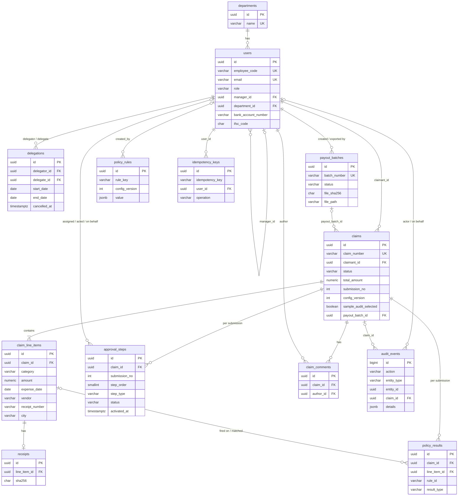

# ExpenseFlow — Database Specification

| Field | Value |
|---|---|
| Status | Draft v0.2 — for team review before any migration or seed code |
| Date | 2026-11-27 |
| Parent spec | `architecture/SPEC.md` **v0.2** (backbone — owns every shared name used here) |
| Sources | `CLAUDE.md` §2 (FR, POL, DATA, CL-01–CL-18, §2.7 routing, §2.8 payout), §4, §5, §6 (Q-##, ASM-###), §8, §9, §13; backbone ASM-S-01–06; `docker-compose.yml`; `backend/src/main/resources/application.properties` |
| Engine | PostgreSQL 18 (`postgres:18` image), database `hackathon`, host port 5433 |
| Access | Spring Data JPA (Hibernate); Flyway migrations (**Proposed — needs ADR-000**, backbone §13) |
| Changes in v0.2 | Aligned to backbone v0.2: `step_status` incl. `SUPERSEDED`, `activated_at`; payout file path; audit `claim_id`/`details`/new entity types and actions; `idempotency_keys`; `config_version`; §4.3 duplicate normalisation; hotel `expense_date` = check-in; `delegations.cancelled_at`; seed routing per backbone §5.2. Issues I-01–I-13 resolved (§11) |

**Rule:** every table, column, enum value and audit action traces to `CLAUDE.md` §2, an answered §6 item, an `ASM-###`/`ASM-S-##` or the backbone. Undecided points cite `SPEC-Q-##`/`Q-##`. Remaining backbone gaps are in §11.

---

## 1. Conventions

| Item | Decision | Why |
|---|---|---|
| Names | snake_case; plural tables; FK columns `<entity>_id`; `ix_` index, `ux_` unique, `ck_` check, `ex_` exclusion, `trg_` trigger | CLAUDE.md §9.4 |
| Primary keys | `id UUID DEFAULT uuidv7()` (PG 18 built-in, time-ordered). Exception: `audit_events.id BIGINT GENERATED ALWAYS AS IDENTITY` | ASM-S-06 (to confirm in ADR-000). Non-guessable IDs add defence in depth for B-10; audit needs strict insertion order |
| Display IDs | `users.employee_code` `EMP0001`, `claims.claim_number` `CLM-YYYY-NNNNN` (set at creation), `payout_batches.batch_number` `PB-YYYY-NNNN` | Backbone §6, CSV §2.8 |
| Timestamps | `TIMESTAMPTZ`, stored UTC; DB `timezone = 'UTC'`; UI shows IST (ASM-002) | §4.3 |
| Calendar dates | `DATE` for expense, check-in/out, delegation dates | ASM-001, ASM-007 |
| Money | `NUMERIC(12,2)`, Java `BigDecimal`; never float | §4.3, backbone §8 |
| Enums | `VARCHAR` + `CHECK (col IN (...))`, JPA `@Enumerated(EnumType.STRING)` | No custom Hibernate types; a list change is one plain migration; readable in SQL |
| Audit columns | `created_at` everywhere; `updated_at` only on tables the app updates (`claims`, `claim_line_items`, `approval_steps`, `delegations`, `payout_batches`, `idempotency_keys`) | Append-only tables never change |
| Deletes | Only draft lines/receipts (API-009, API-010 replace) and expired `idempotency_keys` (24 h) | B-04, backbone §8 |
| FK actions | `NO ACTION` by default; `ON DELETE CASCADE` line → receipt; `ON DELETE SET NULL` for `policy_results` line references | History survives a deleted sent-back line |
| Extensions | `pgcrypto` (bcrypt in the seed), `btree_gist` (delegation overlap). Both trusted, shipped in the image | §7, ASM-007 |

## 2. Table definitions

Legend: **N** = nullable. `id` columns are PK; FKs reference `id`.

### 2.1 `departments` — DATA-001

| Column | Type | N | Default | Constraints | Serves |
|---|---|---|---|---|---|
| id | UUID | No | uuidv7() | PK | |
| name | VARCHAR(100) | No | | UNIQUE | FR-015, CSV `department` |
| created_at | TIMESTAMPTZ | No | now() | | |

### 2.2 `users` — DATA-001/002/005, CL-10, CL-15

| Column | Type | N | Default | Constraints | Serves |
|---|---|---|---|---|---|
| id | UUID | No | uuidv7() | PK | |
| employee_code | VARCHAR(10) | No | | UNIQUE; `~ '^EMP[0-9]{4}$'` | CSV `employee_id` |
| full_name | VARCHAR(150) | No | | | CSV `beneficiary_name` |
| email | VARCHAR(255) | No | | UNIQUE on `lower(email)` | Login (SPEC-Q-07) |
| password_hash | VARCHAR(100) | No | | `~ '^\$2[aby]\$'` (bcrypt) | §8.1, §13 |
| role | VARCHAR(20) | No | 'EMPLOYEE' | CHECK IN (`EMPLOYEE`,`FINANCE_AUDITOR`,`FINANCE_HEAD`,`ADMIN`) | Backbone §2 `user_role` |
| manager_id | UUID | Yes | | FK → users; `ck_users_not_own_manager` `manager_id <> id` | DATA-002; NULL = no manager (CL-09) |
| department_id | UUID | No | | FK → departments | FR-015 |
| bank_account_number | VARCHAR(18) | No | | `~ '^[0-9]{9,18}$'`; UNIQUE | DATA-005, CSV col 7 |
| ifsc_code | CHAR(11) | No | | `~ '^[A-Z]{4}0[A-Z0-9]{6}$'` | DATA-005, CSV col 8 |
| created_at | TIMESTAMPTZ | No | now() | | |

Capabilities (`isManager` etc., backbone §2) are derived by query, not stored. Hierarchy cycles and "at least one `FINANCE_HEAD` exists" (backbone §5.2 rule 4) cannot be CHECKs; the app role cannot modify `users` (§5) and the seed asserts both.

### 2.3 `policy_rules` — POL-001–009, CL-10, B-08 (insert-only)

| Column | Type | N | Default | Constraints | Serves |
|---|---|---|---|---|---|
| id | UUID | No | uuidv7() | PK | |
| rule_key | VARCHAR(64) | No | | CHECK IN the 13 keys of backbone §4.1 | Policy as configuration |
| config_version | INTEGER | No | | `> 0`; UNIQUE (rule_key, config_version) | Backbone §4.1 versioning |
| value | JSONB | No | | Type/range validated by API-035 (backbone §4.1) | Number, boolean or string list |
| created_by | UUID | Yes | | FK → users; NULL only for the baseline | CL-10 |
| created_at | TIMESTAMPTZ | No | now() | | |

Baseline: all 13 keys at `config_version` 1. Each change inserts one row with `max(config_version) + 1`, allocated under `pg_advisory_xact_lock`; never an update. Config "as of V" = per key, the row with the highest `config_version ≤ V` (view `v_policy_config_current` gives the latest). `claims.config_version` stores V at submit and has **no FK** (a version is not unique per row).

### 2.4 `payout_batches` — FR-012–014, CL-06, §2.8, B-09

| Column | Type | N | Default | Constraints | Serves |
|---|---|---|---|---|---|
| id | UUID | No | uuidv7() | PK | |
| batch_number | VARCHAR(12) | No | | UNIQUE; `~ '^PB-[0-9]{4}-[0-9]{4}$'` | CSV col 1, file name |
| status | VARCHAR(10) | No | 'CREATED' | CHECK IN (`CREATED`,`EXPORTED`) | Backbone §6 |
| created_by | UUID | No | | FK → users | `isAdmin` |
| created_at | TIMESTAMPTZ | No | now() | | |
| exported_by | UUID | Yes | | FK → users | |
| exported_at | TIMESTAMPTZ | Yes | | | CSV `value_date` |
| row_count | INTEGER | Yes | | `>= 1` | Control summary |
| total_amount | NUMERIC(12,2) | Yes | | `> 0` | Control summary |
| file_sha256 | CHAR(64) | Yes | | `~ '^[0-9a-f]{64}$'` | Control summary, re-download check |
| file_path | VARCHAR(120) | Yes | | `~ '^[A-Za-z0-9_.-]+$'` (file name only, relative to the exports volume — no path traversal) | Backbone §6 "stored once" |
| updated_at | TIMESTAMPTZ | No | now() | | |

- `ck_payout_batches_exported`: `status = 'EXPORTED'` ⇔ exported_by, exported_at, row_count, total_amount, file_sha256, file_path all NOT NULL.
- `trg_payout_batches_locked` rejects UPDATE/DELETE when `OLD.status = 'EXPORTED'` (§2.8 "never edited").

### 2.5 `claims` — FR-001–005, FR-011–014, CL-02, CL-12, CL-14

| Column | Type | N | Default | Constraints | Serves |
|---|---|---|---|---|---|
| id | UUID | No | uuidv7() | PK | |
| claim_number | VARCHAR(14) | No | | UNIQUE; `~ '^CLM-[0-9]{4}-[0-9]{5}$'`; set at creation | CSV col 11 |
| claimant_id | UUID | No | | FK → users | FR-019 |
| status | VARCHAR(25) | No | 'DRAFT' | CHECK IN persisted `claim_status`: `DRAFT`,`AUTO_REJECTED`,`PENDING_MANAGER`,`PENDING_AUDITOR`,`PENDING_FINANCE_HEAD`,`SENT_BACK`,`REJECTED`,`SAMPLE_AUDIT_PENDING`,`APPROVED`,`IN_PAYOUT_BATCH`,`PAID` | Backbone §3.1 (`SUBMITTED`, `AUTO_APPROVED` audit only) |
| total_amount | NUMERIC(12,2) | No | 0 | `>= 0`; sum of lines, recomputed by the service | CL-03 |
| submission_no | INTEGER | No | 0 | `>= 0`; +1 per submit | CL-12 |
| config_version | INTEGER | Yes | | `> 0` | B-08 |
| submitted_at | TIMESTAMPTZ | Yes | | Latest submit | FR-017 (SPEC-Q-08) |
| decided_at | TIMESTAMPTZ | Yes | | Set on `APPROVED`, `REJECTED`, `AUTO_REJECTED` | FR-017 |
| sample_audit_selected | BOOLEAN | Yes | | NULL = never auto-approved | FR-011, B-12 |
| sample_audit_selected_at | TIMESTAMPTZ | Yes | | Set when selected | `oldest_pending` metric, step `SAMPLE_AUDIT` (backbone §10) |
| payout_batch_id | UUID | Yes | | FK → payout_batches | B-09: one column ⇒ at most one batch |
| created_at / updated_at | TIMESTAMPTZ | No | now() | | |

Checks:
- `ck_claims_batch_state`: `(status IN ('IN_PAYOUT_BATCH','PAID')) = (payout_batch_id IS NOT NULL)` (B-09).
- `ck_claims_sample_state`: `status <> 'SAMPLE_AUDIT_PENDING' OR (sample_audit_selected IS TRUE AND sample_audit_selected_at IS NOT NULL)` (CL-14).
- `ck_claims_submitted`: `status = 'DRAFT' OR (submission_no >= 1 AND submitted_at IS NOT NULL AND config_version IS NOT NULL)`.
- `ck_claims_decided`: `status NOT IN ('APPROVED','IN_PAYOUT_BATCH','PAID','REJECTED','AUTO_REJECTED') OR decided_at IS NOT NULL`.

### 2.6 `claim_line_items` — FR-001, POL-001–009, CL-05, CL-08, ASM-005, backbone §4.4

| Column | Type | N | Default | Constraints | Serves |
|---|---|---|---|---|---|
| id | UUID | No | uuidv7() | PK | |
| claim_id | UUID | No | | FK → claims | |
| line_no | SMALLINT | No | | `> 0`; UNIQUE (claim_id, line_no) | CL-07 reason names the line |
| category | VARCHAR(20) | No | | CHECK IN (`MEALS`,`HOTEL`,`LOCAL_CAB`) — `expense_category`, SPEC-Q-02 | FR-001 |
| amount | NUMERIC(12,2) | No | | `> 0` | FR-001 |
| expense_date | DATE | No | | Not in the future (service check) | FR-001, POL-008, POL-009 |
| vendor | VARCHAR(120) | No | | `char_length(btrim(vendor)) BETWEEN 1 AND 120` | POL-006 |
| receipt_number | VARCHAR(60) | No | | `char_length(btrim(receipt_number)) BETWEEN 1 AND 60` | CL-05, SPEC-Q-15 (required on every line) |
| city | VARCHAR(100) | Yes | | | CL-08 |
| check_in_date | DATE | Yes | | | ASM-005 |
| check_out_date | DATE | Yes | | | ASM-005 |
| nights | INTEGER | Yes | GENERATED ALWAYS AS (check_out_date − check_in_date) STORED | | POL-002/003 limit × nights |
| created_at / updated_at | TIMESTAMPTZ | No | now() | | |

- `ck_line_hotel_fields`: `(category = 'HOTEL') = (city IS NOT NULL AND check_in_date IS NOT NULL AND check_out_date IS NOT NULL)`; `check_out_date > check_in_date`.
- `ck_line_hotel_expense_date`: `category <> 'HOTEL' OR expense_date = check_in_date` (ASM-S-03).
- **CL-05 (expense date + receipt number) is NOT a unique constraint.** A repeat is a `DUPLICATE_FLAG` that routes the claim (POL-009, ASM-004); a unique index would make the insert fail, so the flag could never be raised and the seed could not plant it. The policy engine checks it at submit with the index in §4.
- Duplicate normalisation (backbone §4.3, ASM-S-02) is expressed by these expressions, used in both the indexes and the engine queries:
  - vendor key: `lower(regexp_replace(btrim(vendor), '\s+', ' ', 'g'))`
  - receipt-number key: `upper(btrim(receipt_number))`
- "Earlier lines" = lines of other claims not in `DRAFT`/`AUTO_REJECTED`/`REJECTED`, plus earlier `line_no` in the same claim. POL-006 is limited to the claimant; POL-007/009 span all employees.

### 2.7 `receipts` — FR-001, POL-005, POL-007, §13.5

| Column | Type | N | Default | Constraints | Serves |
|---|---|---|---|---|---|
| id | UUID | No | uuidv7() | PK | |
| line_item_id | UUID | No | | FK → claim_line_items ON DELETE CASCADE; UNIQUE (one file per line, SPEC-Q-06) | FR-001 |
| storage_name | VARCHAR(64) | No | | UNIQUE; generated | §13.5 |
| content_type | VARCHAR(50) | No | | CHECK IN (`application/pdf`,`image/jpeg`,`image/png`) — SPEC-Q-06 | §13.5 |
| size_bytes | BIGINT | No | | `> 0 AND <= 5242880` — SPEC-Q-06 | §13.5 |
| sha256 | CHAR(64) | No | | `~ '^[0-9a-f]{64}$'`; **not unique** (flag, ASM-004) | POL-007, B-07 |
| created_at | TIMESTAMPTZ | No | now() | | |

Receipt presence above `receipt.mandatory_above` is a submit check (ASM-003, `422 RECEIPT_REQUIRED`).

### 2.8 `policy_results` — FR-004, FR-016, CL-07 (insert-only)

| Column | Type | N | Default | Constraints | Serves |
|---|---|---|---|---|---|
| id | UUID | No | uuidv7() | PK | |
| claim_id | UUID | No | | FK → claims | |
| submission_no | INTEGER | No | | `>= 1` | CL-12 |
| line_item_id | UUID | Yes | | FK → claim_line_items ON DELETE SET NULL | Line that fired |
| rule_id | VARCHAR(7) | No | | CHECK IN (`POL-001`..`POL-004`,`POL-006`..`POL-009`) | §2.2 (POL-005 never stored) |
| result_type | VARCHAR(15) | No | | CHECK IN (`LIMIT_BREACH`,`DUPLICATE_FLAG`,`WEEKEND_FLAG`); `ck_policy_results_type_rule` ties type to rule (backbone §4.2) | Routing |
| config_key | VARCHAR(64) | No | | | §2.2 |
| configured_limit | NUMERIC(12,2) | Yes | | Set for LIMIT_BREACH (hotel: limit × nights) | §2.2 |
| actual_value | NUMERIC(12,2) | Yes | | Set for LIMIT_BREACH | §2.2 |
| matched_line_item_id | UUID | Yes | | FK → claim_line_items ON DELETE SET NULL; set for DUPLICATE_FLAG | Backbone §4.2 "matching claim number and line" |
| reason | TEXT | No | | non-blank | §2.2 |
| created_at | TIMESTAMPTZ | No | now() | | |

### 2.9 `approval_steps` — FR-005, FR-008, CL-09, CL-12, CL-16, ASM-009, backbone §5

| Column | Type | N | Default | Constraints | Serves |
|---|---|---|---|---|---|
| id | UUID | No | uuidv7() | PK | |
| claim_id | UUID | No | | FK → claims | |
| submission_no | INTEGER | No | | `>= 1` | CL-12 |
| step_order | SMALLINT | No | | 1–3 = level; UNIQUE (claim_id, submission_no, step_order) | §5.1 |
| step_type | VARCHAR(20) | No | | CHECK IN (`MANAGER`,`FINANCE_AUDITOR`,`FINANCE_HEAD`); `ck_steps_level` ties type to level 1/2/3 | §5.1 |
| assigned_approver_id | UUID | Yes | | FK → users; set only for `MANAGER` (claimant's manager); NULL for pool steps and skipped manager steps | §5.1 |
| status | VARCHAR(12) | No | 'WAITING' | CHECK IN `step_status`: `WAITING`,`PENDING`,`APPROVED`,`REJECTED`,`SENT_BACK`,`SKIPPED`,`SUPERSEDED` | §5.3 |
| activated_at | TIMESTAMPTZ | Yes | | Set when the step becomes `PENDING` | Approval age (NFR-008), FR-017 |
| skip_reason | TEXT | Yes | | Required iff `status = 'SKIPPED'` | §5.3 "reason stored" (§11 I-14) |
| acted_by_id | UUID | Yes | | FK → users | Actor |
| on_behalf_of_id | UUID | Yes | | FK → users; requires acted_by_id | FR-008 |
| acted_at | TIMESTAMPTZ | Yes | | | FR-017 |
| created_at / updated_at | TIMESTAMPTZ | No | now() | | |

- `ck_steps_acted`: `(status IN ('APPROVED','REJECTED','SENT_BACK')) = (acted_by_id IS NOT NULL AND acted_at IS NOT NULL)`.
- `ck_steps_activated`: `status IN ('WAITING','SKIPPED') OR activated_at IS NOT NULL` (a `SUPERSEDED` step that never activated is allowed: `status = 'SUPERSEDED'` also exempt).
- `ux_steps_one_pending`: UNIQUE (claim_id) WHERE status = 'PENDING'.
- Resubmission (CL-12): all non-final steps of the old submission → `SUPERSEDED` in the same transaction as the new rows.
- `trg_steps_no_self_approval` (BEFORE UPDATE): rejects `acted_by_id` = claim's `claimant_id` (B-02) — defence in depth behind `SELF_APPROVAL_FORBIDDEN`.

### 2.10 `claim_comments` — FR-006, FR-007, CL-04 (insert-only)

| Column | Type | N | Default | Constraints | Serves |
|---|---|---|---|---|---|
| id | UUID | No | uuidv7() | PK | |
| claim_id | UUID | No | | FK → claims | |
| author_id | UUID | No | | FK → users | |
| body | TEXT | No | | `btrim(body) <> ''`; max length in the API contract | FR-006 |
| created_at | TIMESTAMPTZ | No | now() | | |

Holds approver comments and the mandatory reject/send-back comments (backbone §6); the matching `audit_events` row (`CLAIM_REJECTED`/`CLAIM_SENT_BACK`) carries the same text in `comment`, which is how API-006 finds the latest send-back comment.

### 2.11 `delegations` — FR-008, CL-13, ASM-007, B-03

| Column | Type | N | Default | Constraints | Serves |
|---|---|---|---|---|---|
| id | UUID | No | uuidv7() | PK | |
| delegator_id | UUID | No | | FK → users | |
| delegate_id | UUID | No | | FK → users; `delegate_id <> delegator_id` | B-03 |
| start_date | DATE | No | | Inclusive, IST calendar date | ASM-007, ASM-002 |
| end_date | DATE | No | | Inclusive; `end_date >= start_date` | ASM-007 |
| cancelled_at | TIMESTAMPTZ | Yes | | NULL = not cancelled (API-021) | Backbone §6 |
| created_at / updated_at | TIMESTAMPTZ | No | now() | | |

- `ex_delegations_no_overlap`: `EXCLUDE USING gist (delegator_id WITH =, daterange(start_date, end_date, '[]') WITH &&) WHERE (cancelled_at IS NULL)` — one active delegation per delegator, race-safe. Violation (SQLSTATE 23P01) maps to `422 DELEGATION_OVERLAP`.
- Delegate role (CL-13) and no pass-on (B-03): service (`INVALID_DELEGATE`) + `trg_delegations_delegate_role` (BEFORE INSERT) as defence in depth.

### 2.12 `idempotency_keys` — backbone §8 (API-012, 015, 016, 017, 023, 026, 028)

| Column | Type | N | Default | Constraints | Serves |
|---|---|---|---|---|---|
| id | UUID | No | uuidv7() | PK | |
| idempotency_key | VARCHAR(100) | No | | | `Idempotency-Key` header |
| user_id | UUID | No | | FK → users | Key scoped to the caller |
| operation | VARCHAR(7) | No | | CHECK IN (`API-012`,`API-015`,`API-016`,`API-017`,`API-023`,`API-026`,`API-028`) | Backbone §8 |
| request_hash | CHAR(64) | No | | `~ '^[0-9a-f]{64}$'` (SHA-256 of path + body) | `IDEMPOTENCY_KEY_REUSED` |
| response_status | SMALLINT | Yes | | NULL while the first request runs | Replay |
| response_body | JSONB | Yes | | | Replay |
| created_at / updated_at | TIMESTAMPTZ | No | now() | | 24 h expiry |

- UNIQUE (user_id, operation, idempotency_key). The row is inserted **first** in the action's transaction and its response filled at the end; a concurrent duplicate blocks on the unique index, then gets a conflict, re-reads the committed row and replays it.
- Rows older than 24 h are deleted by a scheduled backend job (index on `created_at`).

### 2.13 `audit_events` — FR-018, NFR-004, B-11 (append-only)

| Column | Type | N | Default | Constraints | Serves |
|---|---|---|---|---|---|
| id | BIGINT | No | identity (ALWAYS) | PK | Strict order (ASM-S-06) |
| occurred_at | TIMESTAMPTZ | No | clock_timestamp() | | Distinct times within a transaction |
| actor_id | UUID | Yes | | FK → users; NULL = system or unknown login | §4.1 |
| on_behalf_of_id | UUID | Yes | | FK → users | Delegation |
| action | VARCHAR(40) | No | | CHECK IN the 28 actions of backbone §10 | §10 |
| entity_type | VARCHAR(20) | No | | CHECK IN (`CLAIM`,`LINE_ITEM`,`DELEGATION`,`PAYOUT_BATCH`,`POLICY_RULE`,`USER`) | Backbone §6 |
| entity_id | UUID | Yes | | No FK (polymorphic) | |
| claim_id | UUID | Yes | | FK → claims; set for every claim-related event (incl. `LINE_ITEM`, steps, comments, batch membership) | API-013 lookup |
| from_state / to_state | VARCHAR(25) | Yes | | CHECK IN all 13 `claim_status` values | §4.1 |
| comment | TEXT | Yes | | Approver comment, reject/send-back text | CL-04 |
| details | JSONB | Yes | | Evaluation summary, auto-reject reasons, sample draw value (B-12), skip reason, changed config value | Backbone §3.3, §5.5 |
| trace_id | VARCHAR(64) | Yes | | | Backbone §8 |

## 3. ER diagram

## 4. Indexes (beyond PK/UNIQUE above)

| Table | Index | Columns / predicate | Reason |
|---|---|---|---|
| users | ix_users_manager_id | manager_id | Manager queue, `isManager` (DATA-002) |
| users | ix_users_department_id | department_id | Spend by department (FR-015) |
| users | ix_users_role | role | Pool approvers, delegate check (CL-13) |
| claims | ix_claims_claimant_created | (claimant_id, created_at DESC) | "My claims" API-004 |
| claims | ix_claims_pending | (status, submitted_at) WHERE status IN (`PENDING_*`) | Queues API-014/022, queue size |
| claims | ix_claims_sample_pending | sample_audit_selected_at WHERE status = 'SAMPLE_AUDIT_PENDING' | Review queue, `SAMPLE_AUDIT` age metric |
| claims | ix_claims_approved | submitted_at WHERE status = 'APPROVED' | Eligible claims API-025 |
| claims | ix_claims_payout_batch_id | payout_batch_id | Batch detail/export |
| claims | ix_claims_decided_at | decided_at | Approval time (FR-017) |
| claim_line_items | ix_line_items_date_receipt_no | (expense_date, upper(btrim(receipt_number))) | POL-009 |
| claim_line_items | ix_line_items_dup_fields | (expense_date, amount, vendor key §2.6) | POL-006 |
| claim_line_items | ix_line_items_category_date | (category, expense_date) | Spend by category/month; meals per day (SPEC-Q-04) |
| receipts | ix_receipts_sha256 | sha256 | POL-007 (B-07) |
| policy_results | ix_policy_results_claim_sub | (claim_id, submission_no) | Claim detail, violations |
| policy_results | ix_policy_results_rule_created | (rule_id, created_at) | Violations dashboard (FR-016) |
| approval_steps | ix_steps_assignee_pending | assigned_approver_id WHERE status = 'PENDING' | Manager queue |
| approval_steps | ix_steps_type_pending | (step_type, activated_at) WHERE status = 'PENDING' | Pool queues, queue size, oldest pending age (NFR-008) |
| approval_steps | ix_steps_acted_by | acted_by_id | "Acted on" visibility (CL-15, ASM-008) |
| claim_comments | ix_comments_claim | (claim_id, created_at) | Claim thread |
| delegations | ix_delegations_delegate | (delegate_id, start_date, end_date) WHERE cancelled_at IS NULL | Delegate queue (FR-008) |
| idempotency_keys | ix_idempotency_created | created_at | 24 h cleanup |
| audit_events | ix_audit_claim | (claim_id, id) | Claim history API-013 |
| audit_events | ix_audit_entity | (entity_type, entity_id, id) | Delegation/batch/rule history |
| audit_events | ix_audit_occurred | occurred_at | Full trail API-033 |
| audit_events | ix_audit_actor | (actor_id, occurred_at) | Who-did-what |
| audit_events | ix_audit_action | (action, occurred_at) | Sample audit, logins (B-12) |

## 5. Append-only audit and least privilege (NFR-004, B-11, §13.1)

**Roles** (created by a Docker init script from env vars; passwords never in migrations or Git):

| Role | Used by | Rights |
|---|---|---|
| `expenseflow_owner` | Flyway, seed script | Owns the database and every object; never used by the running app |
| `expenseflow_app` | Spring Boot datasource | No CREATE, no ownership; grants below |
| `postgres` | Container bootstrap only | Superuser; not used by app, Flyway or seed |

**Grants to `expenseflow_app`** (last migration, after `REVOKE ALL … FROM PUBLIC`):

| Tables | Privileges |
|---|---|
| `audit_events` | **SELECT, INSERT** only (+ USAGE on its identity sequence) |
| `policy_rules`, `policy_results`, `claim_comments` | SELECT, INSERT |
| `claims`, `approval_steps`, `delegations`, `payout_batches` | SELECT, INSERT, UPDATE |
| `claim_line_items`, `receipts`, `idempotency_keys` | SELECT, INSERT, UPDATE, DELETE |
| `departments`, `users` | SELECT (no user management, Q-20) |
| Views (§8) | SELECT |

**Triggers on `audit_events`** (apply to every role, including the owner):
- `trg_audit_events_no_update_delete` — BEFORE UPDATE OR DELETE FOR EACH ROW → `RAISE EXCEPTION 'audit_events is append-only'`.
- `trg_audit_events_no_truncate` — BEFORE TRUNCATE FOR EACH STATEMENT → same.
- App role fails at the permission check (SQLSTATE 42501); any other role fails at the trigger. Removing a trigger needs a reviewed migration.
- JPA entity `AuditEvent` is `@Immutable`; its repository exposes only `save` and finders.

## 6. Flyway migration plan (Proposed, pending ADR-000)

Source of truth `database/migrations/`, included in the backend build as a **Maven resource** mapped to `db/migration`; the backend Docker build context is the repo root (backbone §13). Flyway runs as `expenseflow_owner` (`spring.flyway.user`), the datasource as `expenseflow_app`, `spring.jpa.hibernate.ddl-auto=validate`.

| # | File | Contents |
|---|---|---|
| 1 | `V001__extensions_and_settings.sql` | `pgcrypto`, `btree_gist`; `ALTER DATABASE … SET timezone = 'UTC'` |
| 2 | `V002__create_departments_users.sql` | §2.1, §2.2 + indexes |
| 3 | `V003__create_policy_rules.sql` | §2.3 + `v_policy_config_current` |
| 4 | `V004__seed_policy_rules_baseline.sql` | 13 rows, `config_version` 1, backbone §4.1 values |
| 5 | `V005__create_payout_batches.sql` | §2.4 + `trg_payout_batches_locked` |
| 6 | `V006__create_claims.sql` | §2.5 + checks + indexes |
| 7 | `V007__create_line_items_receipts.sql` | §2.6, §2.7 + indexes |
| 8 | `V008__create_policy_results.sql` | §2.8 |
| 9 | `V009__create_approval_steps_comments.sql` | §2.9, §2.10 + `trg_steps_no_self_approval` |
| 10 | `V010__create_delegations.sql` | §2.11 + exclusion + `trg_delegations_delegate_role` |
| 11 | `V011__create_idempotency_keys.sql` | §2.12 |
| 12 | `V012__create_audit_events.sql` | §2.13 + indexes + append-only triggers |
| 13 | `V013__create_dashboard_views.sql` | Views in §8 |
| 14 | `V014__grant_app_privileges.sql` | §5 grants and revokes |

Migrations are never edited after merge; fixes are new `V0NN__` files.

## 7. Seed data (`database/seeds/`, DATA-001–005)

| Property | Value |
|---|---|
| Runtime | Python 3.13 + Faker (`en_IN`); `psycopg` 3 (ADR-000, backbone §13) |
| Determinism | `SEED = 20261127` for `random.Random` and `Faker.seed()`; counts are **built by quota**, so exact. Reference date fixed at 2026-11-27 |
| Sample audit | Runtime draw is per claim with `SecureRandom` (ASM-S-05); the seed **plants** an exact historical outcome (100 of 1,000) so tests can assert it |
| Idempotent | One transaction. If `EMP0001` exists → "already seeded", exit 0. Reset = `docker compose down -v` (audit rows are never deleted) |
| Connection | `expenseflow_owner` from env; inserts only. Writes receipt files to `RECEIPTS_DIR` and payout CSVs to `EXPORTS_DIR` |
| Passwords | Demo users: `SEED_DEMO_PASSWORD` env (fails if unset); others random per run. Hashed in SQL with `crypt(pw, gen_salt('bf', 10))` (`$2a$`, accepted by Spring `BCryptPasswordEncoder`). Hashes are the only non-deterministic values |
| Privacy | Faker names; emails `first.last.NNN@expenseflow.test`; no phone, address or real bank data (DATA-004) |
| Policy rules | Loaded by V004 (backbone §4.1): meals 1500.00; hotel tier-1 6000.00 / other 4000.00; tier-1 list + Bengaluru, New Delhi; cab 2000.00; receipt 500.00; duplicate fields vendor/amount/expenseDate; hash true; date+receipt-no true; weekend true; auditor 25000.00; finance head 100000.00; sample 0.10. Seed asserts presence |

### 7.1 Departments and people (150 users)

| Department | Users | Structure |
|---|---|---|
| Finance | 19 | 1 finance head (`FINANCE_HEAD`, no manager), 4 finance auditors (report to the head), 14 staff (3–4 per auditor) |
| Consulting, Engineering, Sales, Marketing, Operations | 19 each | 1 head, 2 team leads (report to head), 16 staff (8 per lead) |
| Human Resources, IT Support | 18 each | 1 head, 2 team leads, 15 staff |

- Heads of Consulting, Engineering, Sales, Marketing, Human Resources report to the finance head; **heads of Operations and IT Support have no manager** (CL-09).
- Roles: 1 `FINANCE_HEAD` (backbone §5.2 rule 4), 4 `FINANCE_AUDITOR`, 145 `EMPLOYEE`, **0 `ADMIN`** (ASM-S-01). Managers (≥ 1 report): 26.
- `EMP0001` (finance head) … `EMP0150`. Bank: unique 12-digit accounts starting `9`; IFSC from fictional codes `XFLB0`, `SYNB0`, `TSTB0` + 6 digits.

| Demo login | Who | Exercises |
|---|---|---|
| `employee@expenseflow.test` | Consulting staff, reports to `manager@…` | Capture, own claims |
| `manager@expenseflow.test` | Consulting team lead | Manager step, delegation |
| `auditor@expenseflow.test` | Finance auditor | Review queue, sample audit, bulk approve, delegate |
| `auditor2@expenseflow.test` | Finance auditor | Own claim > 25,000 (ASM-009), CL-16 approver |
| `financehead@expenseflow.test` | Finance head (`isAdmin`) | Finance-head step, payout, policy config, own claim (CL-16) |
| `nomanager@expenseflow.test` | Operations head | CL-09 skip → auditor |

### 7.2 Claims (3,000) — exact targets; every chain follows backbone §5.2

Expense dates 2025-12-01 … 2026-11-20 (never future), 250 claims per month. Lines: exactly **9,000** (1–8 per claim): MEALS 4,500, LOCAL_CAB 2,700, HOTEL 1,800 (hotel `expense_date` = check-in).

| Final status | Claims | Notes |
|---|---|---|
| `PAID` | 1,950 | 11 `EXPORTED` batches `PB-2025-0001`, `PB-2026-0001`…`0010` (one per month Dec–Oct), CSV files written, `file_path` + `file_sha256` set |
| `IN_PAYOUT_BATCH` | 60 | One `CREATED` batch `PB-2026-0011` |
| `APPROVED` | 220 | |
| `SAMPLE_AUDIT_PENDING` | 25 | |
| `PENDING_MANAGER` / `PENDING_AUDITOR` / `PENDING_FINANCE_HEAD` | 120 / 70 / 25 | `activated_at` within the last 21 days |
| `SENT_BACK` | 40 | `submission_no` 1, one `SENT_BACK` step |
| `REJECTED` | 150 | Incl. 5 sample-audit rejections; comment in `claim_comments` + audit |
| `AUTO_REJECTED` | 160 | All limit breaches |
| `DRAFT` | 180 | No submission data |

| Planted item | Exact count | Rule |
|---|---|---|
| Auto-approved (`sample_audit_selected` NOT NULL) | 1,000; **100 TRUE** (25 pending, 70 approved/paid, 5 rejected) | Never the finance head's claims (SPEC-Q-14) |
| Totals > 1,00,000 / in (25,000, 1,00,000] | 40 / 360 | Chain per CL-03 |
| Boundary totals 25,000.00 / 1,00,000.00 | 5 / 5 | CL-03 |
| POL-001 / 002 / 003 / 004 breach lines | **40 each = 160** | 120 claims × 1 + 20 claims × 2; each meal breach is a single line > 1,500 (independent of SPEC-Q-04) |
| At-limit lines (1,500.00; 6,000.00 × nights; 4,000.00 × nights; 2,000.00) | 10 each | Must pass |
| Tier-1 spellings (`Bengaluru`, `New Delhi`, ` mumbai `) | 10 hotel lines | CL-08, ASM-006 |
| POL-006 / 007 / 009 duplicate pairs | **30 each = 90 flagged lines** | Same claimant (valid under §4.3 scopes); vendor pairs differ only by case/spaces in 10 cases; receipt-number pairs differ by case/spaces in 10 cases; each pair matches only its own rule; the earlier line's claim is never `DRAFT`/`AUTO_REJECTED`/`REJECTED` |
| Weekend lines | **300** | Only in routed claims; all other lines weekdays |
| `policy_results` rows | 160 + 90 + 300 = **550** | All other vendor keys, receipt keys and hashes are unique |
| Resubmitted claims (`submission_no` = 2) | 30 | Clean lines, routed by amount; submission-1 steps `SUPERSEDED` |
| No-manager heads' claims | 20 | 10 routed: `MANAGER` `SKIPPED` + `FINANCE_AUDITOR` (added if not required, §5.2 rule 3); 10 clean ≤ 25,000 auto-approved |
| Finance head's claims | 12 | All routed; chain = one `FINANCE_AUDITOR` step (CL-16); none auto-approved |
| Finance auditors' claims > 25,000 | 8 | `MANAGER` (finance head) → `FINANCE_AUDITOR` `SKIPPED` → `FINANCE_HEAD` (ASM-009) |

- Receipts: every line > 500.00 in a non-draft claim has one; minimal hand-built PDFs with unique text (no extra library); POL-007 pairs share identical bytes.
- Audit: every historical transition gets back-dated rows with `claim_id`, the backbone §10 actions (`CLAIM_ROUTED`, `STEP_ACTIVATED`, `STEP_SKIPPED`, `CLAIM_ADDED_TO_BATCH`, …) and `details`.
- The script prints a manifest of every count above; pytest asserts them.

## 8. Data rules

| Topic | Rule |
|---|---|
| Retention | Nothing is deleted except draft lines/receipts and idempotency rows after 24 h. Reset = drop the Docker volumes |
| PII | Synthetic only (DATA-004); never log receipt contents, password hashes or bank numbers (§11.10) |
| Dashboards (backbone §7.3, SPEC-Q-11) | Plain views, filtered and grouped by parameterized JPA queries (no materialized views needed): `v_spend_lines` (line amount, category, claimant department, `expense_date` month, for `APPROVED`/`IN_PAYOUT_BATCH`/`PAID`); `v_policy_violations` (results of each claim's latest `submission_no`); `v_claim_approval_times` (`submitted_at` → `decided_at` for approved claims, SPEC-Q-08) |
| Metrics | Queue size = `PENDING` steps per `step_type` + `SAMPLE_AUDIT_PENDING` claims; oldest age = now − min(`activated_at`) or min(`sample_audit_selected_at`) (backbone §10) |
| Concurrency | READ COMMITTED. Submit, approve, reject, send-back, sample review: `SELECT … FOR UPDATE` on the claim, then re-check state (→ 409). Bulk approve: one transaction per claim. Batch create/export lock claims **in id order**; export locks the batch row first. Duplicate checks at submit run under one `pg_advisory_xact_lock`. Config version allocation uses its own advisory lock. Delegation overlap via exclusion constraint; idempotency via unique index (§2.12) |
| Transactions | State change + audit + steps/results (+ idempotency row) in one transaction (§11.8, §11.9) |

## 9. Ordered task list

| # | Task | Requirements | Done-check |
|---|---|---|---|
| 1 | ADR-000 entries: UUIDv7/bigint audit (ASM-S-06), CHECK enums, Flyway as Maven resource, psycopg, two DB roles | §8.1, §13.1 | ADR merged |
| 2 | Docker init script for `expenseflow_owner`/`expenseflow_app` from env; `.env.example` placeholders; receipts and exports volumes | §13.1, §13.6 | `\du` shows both roles; no password in Git |
| 3 | Build wiring: backend context = repo root, Maven resource `database/migrations` → `db/migration`, `ddl-auto=validate`, Flyway vs app credentials | §8.1, NFR-006 | `docker compose up` applies V001–V014 on an empty volume; backend connects as `expenseflow_app` |
| 4 | V001–V004 | DATA-001/002/005, POL-001–009, CL-10 | 13 rows at `config_version` 1; bad IFSC/account rejected |
| 5 | V005–V007 | FR-001–003, FR-012, CL-05, CL-08, ASM-005, ASM-S-03, B-09 | Batched `APPROVED` claim rejected; hotel with `expense_date` ≠ check-in rejected; duplicate date+receipt-no **insert succeeds** |
| 6 | V008–V009 | FR-004, FR-005, CL-12, B-02 | Two `PENDING` steps rejected; self-approval update rejected; `SKIPPED` without reason rejected |
| 7 | V010–V011 | FR-008, CL-13, ASM-007, B-03, backbone §8 | Overlapping delegation → 23P01; non-finance delegate rejected; duplicate idempotency key → unique violation |
| 8 | V012 + V014 | FR-018, NFR-004, B-11 | As app: UPDATE/DELETE on `audit_events` → 42501; as owner: UPDATE/DELETE/TRUNCATE → trigger error; INSERT works |
| 9 | V013 views | FR-015–017 | Views return rows on seeded data |
| 10 | JPA entities match schema | §9.2 | Backend starts with `validate` |
| 11 | Seed: departments, users, hierarchy, demo logins | DATA-001/002/004/005, CL-09, ASM-S-01 | 150 users, 8 departments, 2 heads with NULL manager, ≥ 1 finance head, 0 admins, demo logins work |
| 12 | Seed: claims, lines, receipts, results, steps, batches + files, audit | DATA-003, FR-011, POL-001–009, CL-16, ASM-009 | Every §7.2 count matches; every chain re-computed by the chain engine equals the seeded steps; second run exits "already seeded" |
| 13 | pytest DB assertions (counts, append-only, constraints) on the Docker stack | DATA-003, NFR-004 | Green in CI |
| 14 | Update `database/README.md` (commands, `V001__` naming) | §17 | README matches this spec |

## 10. Open questions referenced

| ID | Affects here |
|---|---|
| SPEC-Q-02 | `category` CHECK list |
| SPEC-Q-03 | Send-back comment → `claim_comments` |
| SPEC-Q-04 / Q-11 | Meals per-day aggregation; seed breaches are single lines |
| SPEC-Q-05 | Duplicate scope (§2.6 follows backbone §4.3 default) |
| SPEC-Q-06 / Q-21 | `receipts.content_type`, `size_bytes`, one file per line |
| SPEC-Q-07 / Q-22 | `email` + `password_hash` login |
| SPEC-Q-08 / Q-23 | `decided_at`, approval-time view |
| SPEC-Q-10 / Q-25 | Lines complete at insert; receipt at submit |
| SPEC-Q-11 | Spend view definition |
| SPEC-Q-14 | Finance head's clean claims routed (seed) |
| SPEC-Q-15 | `receipt_number` NOT NULL on every line |
| Q-06, Q-13, Q-20 | Not modelled |

## 11. Issues found in `architecture/SPEC.md`

**Resolved by backbone v0.2:**

| ID | Issue (v0.1) | Resolution |
|---|---|---|
| I-01 | `approval_steps.status` undefined | `step_status` §5.3 (+ `SUPERSEDED`, `activated_at`) |
| I-02 | `payout_batches.status` undefined | `CREATED`, `EXPORTED` (§6) |
| I-03 | Audit entity types, line ID, structured details | `entity_type` list, `claim_id`, `details` JSONB (§6) |
| I-04 | `ADMIN` ambiguity | ASM-S-01; `ADMIN` never approves |
| I-05 | Config version entity | Insert-only `policy_rules` + global `config_version`, no FK (§4.1) |
| I-06 | Category spelling | `MEALS`, `HOTEL`, `LOCAL_CAB` (§4.4) |
| I-07 | Duplicate normalisation | §4.3, ASM-S-02 |
| I-08 | "Earlier line" scope, duplicate actual value | §4.3, §4.2 |
| I-09 | Home of reject/send-back comments | `claim_comments` (§6) |
| I-10 | Dashboard spend definition | §7.3, SPEC-Q-11 |
| I-11 | Hotel expense date | = check-in (ASM-S-03) |
| I-12 | Re-download same file | Stored file path + SHA-256 (§6) |
| I-13 | Display IDs | `employee_code`, `claim_number`, `batch_number` (§6) |

**Still open / new:**

| ID | Issue | Used here until resolved |
|---|---|---|
| I-14 | §5.3 says a skip "reason [is] stored" but defines no field or value list | `approval_steps.skip_reason TEXT` (+ audit `details`); suggest fixed values e.g. `NO_APPROVER`, `CLAIMANT_IS_APPROVER` in the backbone |
| I-15 | §6 "sample-audit fields" not enumerated; the §10 metric needs a selection time | `sample_audit_selected`, `sample_audit_selected_at` |
| I-16 | Idempotency for API-023 (bulk, one transaction per claim) — when is the stored response written, and what does a concurrent duplicate get? | Row inserted first in its own transaction with `response_status` NULL; a duplicate arriving while NULL gets `409 STATE_CONFLICT` — needs backbone confirmation |
| I-17 | SPEC-Q-08: for a resubmitted claim, is approval time measured from the first or the latest submit? | Latest (`claims.submitted_at`) |

**Repository issues (not backbone):**

| ID | Issue | Status |
|---|---|---|
| R-01 | Backend build context `./backend` cannot see `database/migrations` | Decided in backbone §13 (context → repo root); task 3 |
| R-02 | `ddl-auto=update` conflicts with Flyway | Decided (`validate`); task 3 |
| R-03 | Backend connects as `postgres` superuser (§13.1) | Open until task 2–3 done |
| R-04 | `database/README.md` shows `001_create_users.sql` | Task 14 |
| R-05 | Prometheus/Grafana images use `:latest` | Listed for ADR-000 (backbone §13) |
| R-06 | `docker-compose.yml` has no receipts or exports volume | Task 2 |
